# EchoNotes 🎙️→📝

[](https://github.com/mrfmanuel/EchoNotes/actions/workflows/ci.yml)
[](https://github.com/mrfmanuel/EchoNotes/actions/workflows/deploy-dev.yml)
[](https://github.com/mrfmanuel/EchoNotes/actions/workflows/deploy-prod.yml)

> ### 🚀 Live demo: **<https://echonotes-prod.onrender.com>**
> Dev (latest `main`): <https://echonotes-dev.onrender.com> · Health: [`/api/health`](https://echonotes-prod.onrender.com/api/health) shows the deployed commit.
>
> ⚠️ **The demo has no login. Anyone with the link can see every project, so do not upload sensitive or personal audio.** Free hosting sleeps after 15 min idle; the first request can take ~30–60 s.

**Turn audio into organized text notes.** Drop or record audio inside a project, get a transcript in seconds, attach the screenshots that belong with it, and export everything as a clean folder of Markdown and images.

Final project for the [AI Dev Tools Zoomcamp 2026](https://courses.datatalks.club/ai-dev-tools-2026/). Built with a team of AI agents (Claude Code subagents) working through a [public issue tracker](https://github.com/mrfmanuel/EchoNotes/issues).

> **Status: v1.0.0 (end of prompt P4: every rubric criterion delivered).** The app works end to end and is live on Render (dev + prod, each with its own Neon Postgres).
> - **CI/CD:** CI runs on every PR. A green CI on `main` deploys dev automatically. Prod is promoted manually behind an approval gate, with automatic rollback.
> - **Telemetry:** the key journey emits OpenTelemetry traces, metrics and logs that share a trace ID, viewable in a local Grafana stack.
> - **Alerting:** a user-impact alert wakes an **on-call agent**. The agent investigates from evidence, fixes the bug in an isolated worktree under a policy enforced in code, opens a PR and verifies recovery. This was demonstrated for real and the evidence is committed.

## How to review this project in 10 minutes

| Minute | What | Where |
|---|---|---|
| 1 | **Use the live app** (no login, so don't upload sensitive audio): create a project, upload or record audio, edit the transcript, export a ZIP. The footer shows the deployed version and commit | <https://echonotes-prod.onrender.com> (first load may take about 60 s) · [`/api/health`](https://echonotes-prod.onrender.com/api/health) |
| 2 | **Spec, tracker and agent team:** user stories with Given/When/Then ACs, issues with AC checklists and QA reports on every PR | [product-spec.md](docs/product-spec.md) · [Issues](https://github.com/mrfmanuel/EchoNotes/issues?q=is%3Aissue) · [PRs](https://github.com/mrfmanuel/EchoNotes/pulls?q=is%3Apr) · [agent-team.md](docs/agent-team.md) · [AGENTS.md](AGENTS.md) |
| 3 | **Run it locally with one command** (Docker): no `.env` needed, uses the fake transcriber | `docker compose up --build` → <http://localhost:8000> |
| 4 | **All tests with one command:** backend unit + integration on a throwaway Postgres + frontend + responder | `make test` ([testing.md](docs/testing.md)) |
| 5 | **CI/CD with real runs:** required CI checks, automatic dev deploy, prod deploy behind approval, rollback demo | [Actions](https://github.com/mrfmanuel/EchoNotes/actions) · [release-process.md → evidence](docs/release-process.md#evidence-real-runs-2026-11-1011) |
| 6 | **Observability:** `make obs-up`, then open Grafana <http://localhost:3000> (admin/admin, local only) → dashboard *EchoNotes key journey*, Explore (Tempo ↔ Loki by `trace_id`) | [observability.md](docs/observability.md) · screenshots below |
| 7–8 | **Alert → on-call agent → fix, in one command:** injects a bug on a throwaway branch, fires the alert and lets the responder run headless Claude Code, then verifies recovery (about 5 min; needs `gh` and `claude` logged in) | `make incident` · cleanup `make incident-cleanup` · [on-call.md](docs/on-call.md) |
| 9 | **Read the incident that already happened:** alert, evidence, model and configuration, policy decision, commands, recovery | [operations-and-security-report.md](docs/operations-and-security-report.md) · [INC-20261111-052713](incident-response/incidents/INC-20261111-052713/) · responder PR [#56](https://github.com/mrfmanuel/EchoNotes/pull/56) |
| 10 | **How AI built it:** prompts, agents, what went wrong, what humans verified | [ai-usage-report.md](docs/ai-usage-report.md) · [prompts/](prompts/) |

---

## The problem

Voice memos are the fastest way to capture a lecture, a meeting or an idea, and the slowest thing to use afterwards. Recordings pile up in phone apps, the screenshots that go with them (a slide, a diagram, an error message) live somewhere else, and turning them into usable text means juggling a recorder, a transcription service, an editor and a file manager.

## Who it is for

- **Students** who record lectures (often bilingual) and screenshot slides
- **Developers** who record quick voice memos about bugs and paste error screenshots
- **Content creators** who draft scripts by talking

See the personas in the [product spec](docs/product-spec.md#2-personas).

## Functionality

| Area | What you can do | Spec |
|---|---|---|
| Projects (folders) | Create, list, rename and delete projects. Deleting a project removes everything in it | [US-01–04](docs/product-spec.md#31-projects) |
| Audio → transcript | Upload **mp3 / wav / m4a / ogg / webm** (≤ 25 MB) **or record** in the browser, with an optional language hint (Auto / en / es / pt) | [US-05–07](docs/product-spec.md#us-05) |
| Transcripts | View, edit title and text, **copy to clipboard**, **download `.md` / `.txt`**, delete | [US-08–11](docs/product-spec.md#us-08) |
| Screenshots | Attach png / jpg / webp (≤ 5 MB) with the file picker **or Ctrl+V paste**, link one to a transcript, thumbnail gallery, delete | [US-12–15](docs/product-spec.md#33-screenshots) |
| Export | Download a project as a ZIP: `<slug>/README.md`, `transcripts/*.md` and `*.txt`, `screenshots/*` | [US-16](docs/product-spec.md#us-16) |
| Health | `GET /api/health` → status, version, database, deployed commit, environment (also in the UI footer) | [US-17](docs/product-spec.md#us-17) |

## Expected behavior

- **Key journey:** *create project → upload audio → transcript visible and editable → export ZIP* ([sequence diagram](docs/product-spec.md#4-key-user-journey)).
- Invalid files are rejected with clear messages (`415` for a wrong type, `413` for a file that is too large). Provider failures show a retry hint (`502` / `504`) and never leave an empty transcript behind.
- **Privacy:** raw audio is **never stored**. It is discarded right after transcription. Transcript text and file contents are **never written to logs or telemetry**.
- Transcription goes through a pluggable `Transcriber`: **`groq`** (Groq Whisper `whisper-large-v3-turbo`) for real use, and a deterministic **`fake`** provider so the app, the tests and CI run without an API key.
- **Non-goals:** accounts/auth, sharing, real-time streaming, speaker diarization, mobile apps. The app has **no authentication**, so do not put sensitive audio on a public deployment.

Full acceptance criteria (Given/When/Then): [docs/product-spec.md](docs/product-spec.md). API contract: [openapi.yaml](openapi.yaml).

## Screenshots

| Projects | Project page |
|---|---|
| 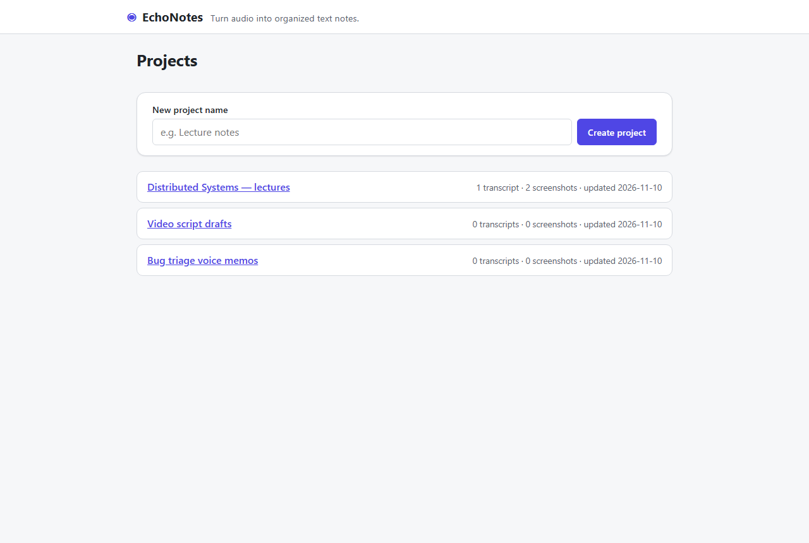 | 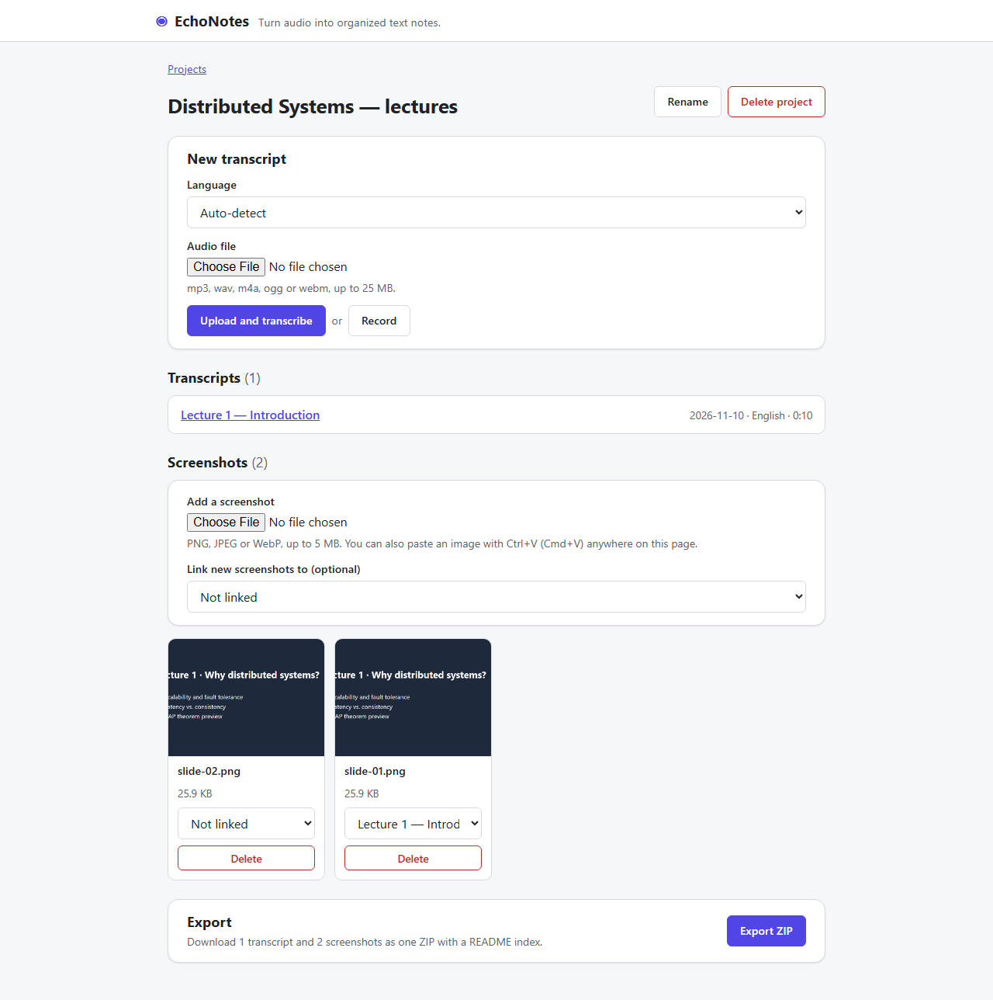 |
| **Transcript editor** | **Mobile (390 px)** |
| 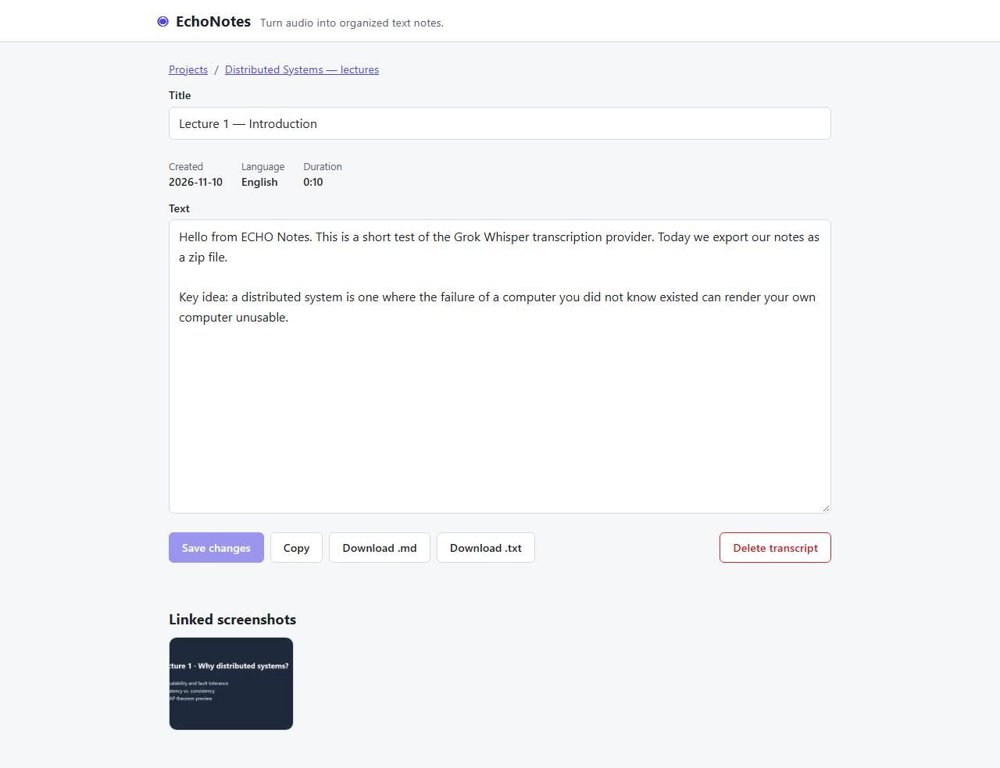 | 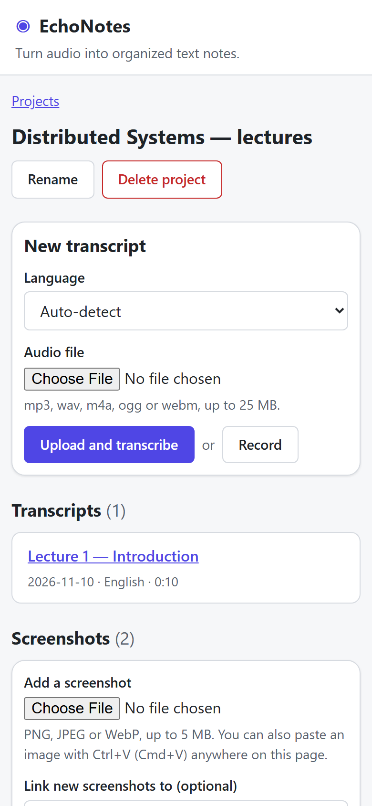 |

The transcript shown was produced by the real Groq provider from a synthesized speech clip during the P2 verification.

### Observability and on-call (INC-20261111-052713, live demo)

| Dashboard during the incident (40 % failures) | Firing user-impact alert |
|---|---|
| 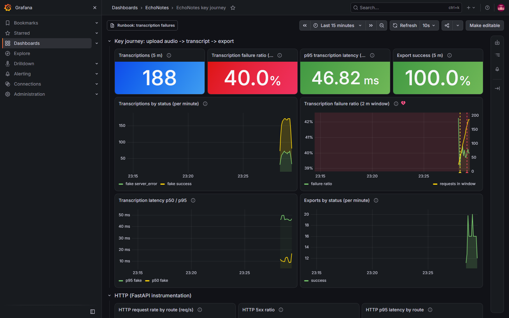 | 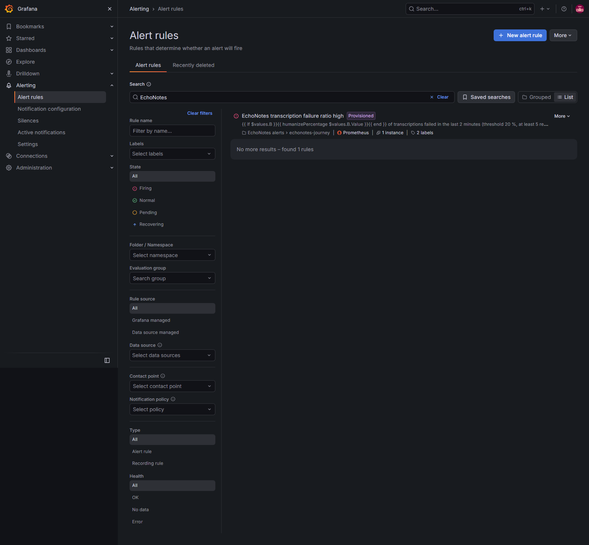 |
| **A failing trace with its correlated logs (same `trace_id`)** | **The PR opened by the on-call agent** |
| 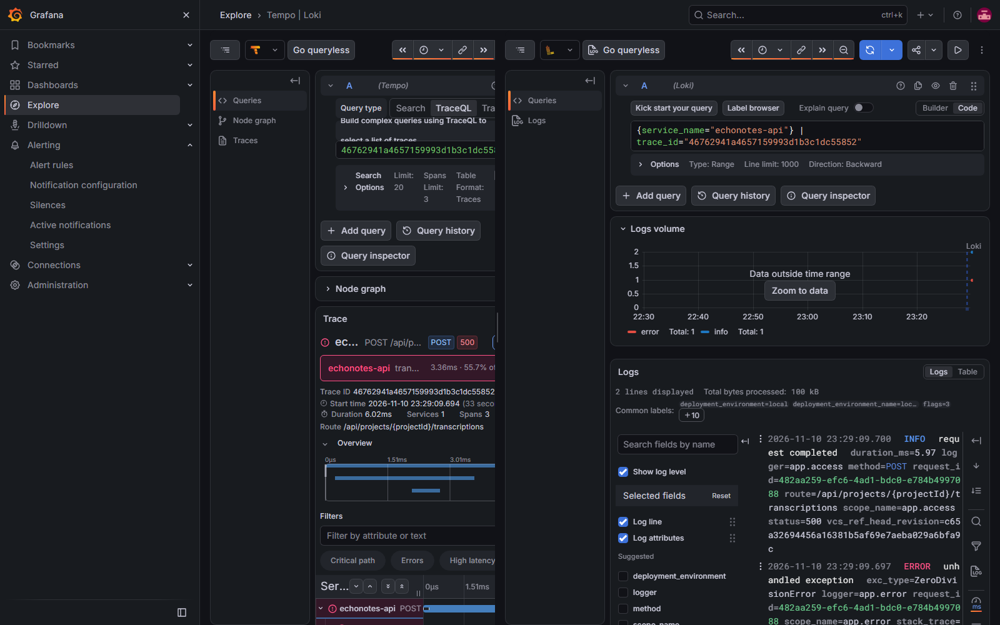 | 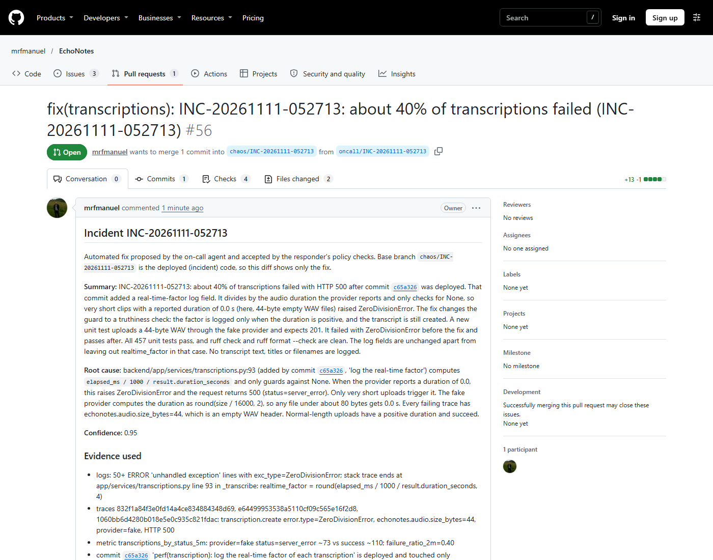 |

## Architecture (short)

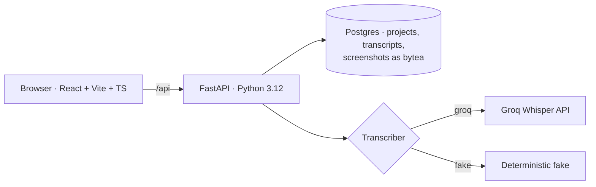

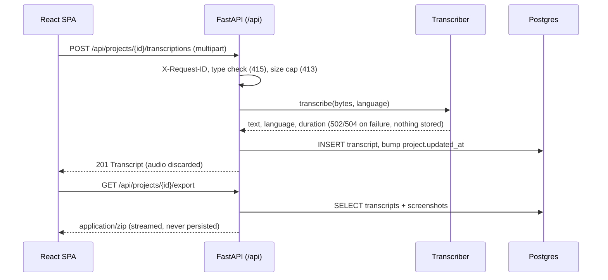

In production, one Docker image serves both the API and the built SPA. Images are stored in Postgres because the hosting disk (Render) is ephemeral. Details: [docs/architecture.md](docs/architecture.md).

### Deployment and CI/CD (short)

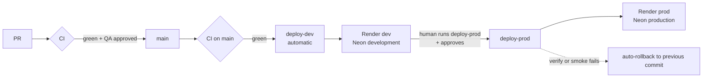

Every deploy targets an exact commit, waits until `/api/health` reports it, then runs the smoke test. Rollback: `gh workflow run rollback.yml -f environment=prod -f ref=<sha>` or Render's dashboard. Details: [docs/deployment.md](docs/deployment.md) and [docs/release-process.md](docs/release-process.md) (with links to real runs).

### Observability and on-call (short)

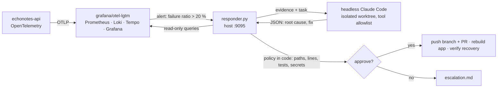

Details: [docs/observability.md](docs/observability.md), [docs/on-call.md](docs/on-call.md), [docs/operations-and-security-report.md](docs/operations-and-security-report.md).

## Run locally

| Way | Command | Status |
|---|---|---|
| Whole system (app + Postgres) | `docker compose up --build` (or `make up`) → <http://localhost:8000>; stop with `docker compose down` (keeps data) or `docker compose down -v` (wipes it). No `.env` needed: it uses the fake transcriber and a local Postgres. | ✅ available |
| Backend only | `cd backend && uv sync && uv run alembic upgrade head && uv run uvicorn app.main:app --loop app.event_loop:new_event_loop --reload --port 8000` → <http://localhost:8000/api/health> (needs Postgres at `DATABASE_URL`; add `--env-file ../.env` after `uv run` to load `.env`). `--loop app.event_loop:new_event_loop` is required on native Windows (psycopg cannot use the default Proactor loop, see #41) and harmless elsewhere; `--reload` is optional. | ✅ available |
| Frontend dev server | `cd frontend && npm ci && npm run dev` → <http://localhost:5173> (proxies `/api` to the backend on :8000) | ✅ available |
| With observability (Grafana LGTM) | `make obs-up` → app <http://localhost:8000> + Grafana <http://localhost:3000> (admin/admin, local only), dashboard *EchoNotes key journey*, alert *EchoNotes transcription failure ratio high*; stop with `make obs-down`. See [docs/observability.md](docs/observability.md) | ✅ available |
| On-call demo (alert → agent → fix PR → recovery) | `make incident` (Git Bash; needs Docker, `uv`, `gh` and `claude` logged in; ports 8001/3001/9095), then `make incident-cleanup`. See [docs/on-call.md](docs/on-call.md) | ✅ available |
| Smoke test of a running stack | `make smoke` or `bash scripts/smoke.sh http://localhost:8000` (health → project → upload → transcript → screenshot → export ZIP → cleanup) | ✅ available |

Transcription uses `TRANSCRIBER_PROVIDER=fake` by default. For real transcripts, set `TRANSCRIBER_PROVIDER=groq` and `GROQ_API_KEY` in `.env` (never commit it).

## Run tests

```bash
cd backend  && uv run ruff check . && uv run pytest          # backend lint + tests
cd frontend && npm run lint && npm run typecheck && npm test  # frontend lint + types + tests
```

One command for backend unit + integration (throwaway Postgres on port 55432) + frontend + on-call responder tests: `make test`. Without Docker: `make test-unit`. Lint everything: `make lint`. See [docs/testing.md](docs/testing.md). CI runs all of the above on every pull request and on every push to `main` ([ci.yml](.github/workflows/ci.yml)).

## Documentation

| Doc | Content |
|---|---|
| [AGENTS.md](AGENTS.md) (imported by [CLAUDE.md](CLAUDE.md)) | Entry point for agents: stack, layout, commands, conventions, rules |
| [docs/product-spec.md](docs/product-spec.md) | Problem, personas, user stories with Given/When/Then ACs, NFRs, non-goals |
| [openapi.yaml](openapi.yaml) | OpenAPI 3.1 contract between frontend and backend |
| [docs/agent-team.md](docs/agent-team.md) | Agent roles, hand-offs, workflow diagram |
| [docs/process.md](docs/process.md) | Issues, labels, branches, commits, PRs, definition of done |
| [docs/architecture.md](docs/architecture.md) | Components, data model, Transcriber interface |
| [docs/testing.md](docs/testing.md) | Test pyramid, suites, counts and commands |
| [docs/deployment.md](docs/deployment.md) | Architecture, environments (Render + Neon), secrets, setup, free-tier caveats, migrations |
| [docs/release-process.md](docs/release-process.md) | Dev → prod promotion, approval gate, rollback, evidence runs |
| [docs/observability.md](docs/observability.md) | Telemetry, local Grafana stack, dashboard, alert, evidence API and privacy rules; runbook: [docs/runbooks/transcription-failures.md](docs/runbooks/transcription-failures.md) |
| [docs/on-call.md](docs/on-call.md) | On-call responder loop, capability table, autonomy policy, escalation |
| [docs/operations-and-security-report.md](docs/operations-and-security-report.md) | Incident INC-001 reconstructed end to end + responder security review |
| [docs/ai-usage-report.md](docs/ai-usage-report.md) | How AI tools and agents were used, with a retrospective |
| [prompts/](prompts/) | The prompts given to Claude Code |

## Course rubric mapping (self-score)

The 12 criteria of the [course project](https://github.com/DataTalksClub/ai-dev-tools-zoomcamp) (24 points). Each row links its evidence. The `product-manager` and `qa-engineer` agents audited this table independently before v1.0.0 ([#33](https://github.com/mrfmanuel/EchoNotes/issues/33)).

| # | Criterion | Evidence | Self-score |
|---|---|---|---|
| 1 | Problem description | This README: [problem](#the-problem), [who it is for](#who-it-is-for), [functionality](#functionality), [expected behavior](#expected-behavior), [screenshots](#screenshots) | **2 / 2** |
| 2 | Product specification | [docs/product-spec.md](docs/product-spec.md) (US-01–US-21 with Given/When/Then ACs, NFRs) + [openapi.yaml](openapi.yaml) (contract-tested). Public tracker: [issues](https://github.com/mrfmanuel/EchoNotes/issues?q=is%3Aissue), [milestones M1–M4](https://github.com/mrfmanuel/EchoNotes/milestones?state=closed), [project board](https://github.com/users/mrfmanuel/projects/2). Every issue has an AC checklist; agents groomed the issues, linked PRs to them and closed them with evidence comments. The AC evidence for each issue is in its closing comment and in the QA report on its PR | **2 / 2** |
| 3 | Agent team specification | [.claude/agents/](.claude/agents/) (product-manager, software-engineer, qa-engineer, devops-sre) + [docs/agent-team.md](docs/agent-team.md) (roles, hand-offs, diagram). Every PR (#36–#55) followed PM grooming → engineer → independent `qa-engineer` report → merge. QA requested changes on 4 PRs (#38, #50, #52, #53) and found real defects each time. Details in the [AI usage report](docs/ai-usage-report.md) | **2 / 2** |
| 4 | Context management | [AGENTS.md](AGENTS.md) (imported by [CLAUDE.md](CLAUDE.md)) → modular docs: [process](docs/process.md), [agent team](docs/agent-team.md), [architecture](docs/architecture.md), [testing](docs/testing.md), [deployment](docs/deployment.md), [release](docs/release-process.md), [observability](docs/observability.md), [on-call](docs/on-call.md) | **2 / 2** |
| 5 | Application | FastAPI + React SPA + Postgres, end to end. The frontend calls a typed `/api` client and data persists in Postgres. One command: `docker compose up --build` → <http://localhost:8000> ([screenshots](#screenshots), live: <https://echonotes-prod.onrender.com>) | **2 / 2** |
| 6 | Testing | **713 tests**: 456 backend unit + 38 backend integration (real Postgres) + 136 frontend (Vitest) + 83 on-call responder (stub agent). Also a contract test against `openapi.yaml`, privacy tests for logs and telemetry, and a smoke script. **One command, `make test`**, passes locally and in CI ([docs/testing.md](docs/testing.md)) | **2 / 2** |
| 7 | Containerization | Multi-stage [Dockerfile](Dockerfile): SPA + API in one non-root image, migrations on start, HEALTHCHECK. [docker-compose.yml](docker-compose.yml) adds Postgres 16 and starts the full system with one command and no `.env`; the `observability` profile adds Grafana LGTM. CI builds the image and smoke-tests it | **2 / 2** |
| 8 | Deployment | **Live:** prod <https://echonotes-prod.onrender.com>, dev <https://echonotes-dev.onrender.com>. Render Docker services with a separate Neon Postgres per environment; `/api/health` shows the deployed commit ([docs/deployment.md](docs/deployment.md)) | **2 / 2** |
| 9 | CI/CD | [CI](.github/workflows/ci.yml) on every PR (required checks on `main`). CD: [deploy-dev](.github/workflows/deploy-dev.yml) runs **automatically** after a green CI on `main`; [deploy-prod](.github/workflows/deploy-prod.yml) is **manual, behind a required-reviewer approval**, with auto-rollback; [rollback](.github/workflows/rollback.yml) was tested. Real runs: [release-process.md → evidence](docs/release-process.md#evidence-real-runs-2026-11-1011) | **3 / 3** |
| 10 | Observability | OpenTelemetry on the key journey (upload audio → transcript → export): **traces** (FastAPI, SQLAlchemy, `transcription.create`, `export.build`, `groq.transcribe`), **metrics** (`echonotes_transcriptions_total{provider,status}`, duration histogram, exports, HTTP), **structured JSON logs** with `trace_id`/`span_id`. All three are collected and stored in Prometheus, Loki and Tempo and shown in Grafana (`make obs-up`). Privacy tests check that no customer data or credentials reach telemetry ([docs/observability.md](docs/observability.md), [screenshots](#observability-and-on-call-inc-20261111-052713-live-demo)) | **2 / 2** |
| 11 | Alerting on user impact | [observability/alerts.yaml](observability/alerts.yaml): *transcription failure ratio > 20 % over 2 min with at least 5 requests*. This is user impact, not CPU. Labels: severity and journey; runbook [transcription-failures.md](docs/runbooks/transcription-failures.md); webhook to the responder. It fired for real in INC-20261111-052713 | **1 / 1** |
| 12 | On-call agent | The alert wakes [`responder.py`](incident-response/responder.py). It collects evidence, runs **headless Claude Code** in an isolated worktree, and checks the result against a policy enforced in code. The agent **fixed the bug**: PR [#56](https://github.com/mrfmanuel/EchoNotes/pull/56), rebuild, recovery verified. The PR targeted the throwaway chaos branch and was closed after verification, because the injected bug never reached `main`. Saved evidence: [INC-20261111-052713](incident-response/incidents/INC-20261111-052713/), plus a real escalation in [INC-20261111-051629](incident-response/incidents/INC-20261111-051629/) ([docs/on-call.md](docs/on-call.md), [operations-and-security-report.md](docs/operations-and-security-report.md)) | **2 / 2** |
| | **Total** | | **24 / 24** |

Known limits, kept honest:
- The live demo has no authentication.
- Prod telemetry is optional and not wired up; the local stack is the UI. Grafana Cloud is the documented next step.
- The on-call demo runs against the local incident stack, not Render prod.
- There is no availability alert yet ([#54](https://github.com/mrfmanuel/EchoNotes/issues/54), `future`).

## License

MIT
