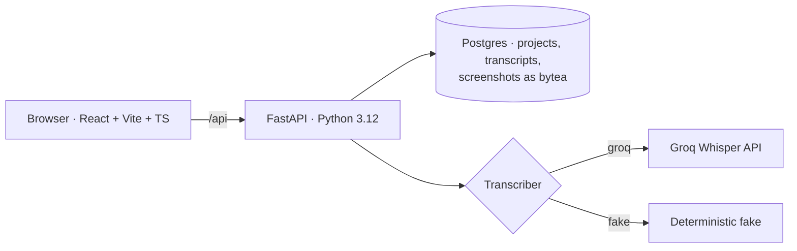
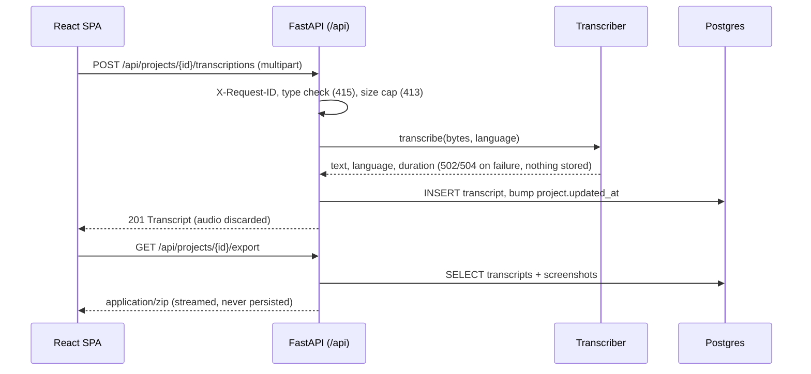

# EchoNotes 🎙️→📝

[](https://github.com/mrfmanuel/EchoNotes/actions/workflows/ci.yml)

**Turn audio into organized text notes.** Drop or record audio inside a project, get a transcript in seconds, attach the screenshots that belong with it, and export everything as a clean folder of Markdown and images.

Final project for the [AI Dev Tools Zoomcamp 2026](https://courses.datatalks.club/ai-dev-tools-2026/). Built with a team of AI agents (Claude Code subagents) working through a [public issue tracker](https://github.com/mrfmanuel/EchoNotes/issues).

> **Status (end of prompt P2 — app):** the full application works end to end: projects, upload/record → transcript (Groq Whisper or a fake provider), edit/copy/download, screenshots (picker + Ctrl+V), ZIP export. It runs with **one command** (`docker compose up --build`), has **unit + integration + frontend tests behind one command** (`make test`) and CI on every PR. Deployment arrives in **P3** and observability/on-call in **P4**; those items are marked *planned* below.

---

## The problem

Voice memos are the fastest way to capture a lecture, a meeting or an idea, and the slowest thing to use afterwards. Recordings pile up in phone apps, the screenshots that go with them (a slide, a diagram, an error message) live somewhere else, and turning them into usable text means juggling a recorder, a transcription service, an editor and a file manager.

## Who it is for

- **Students** who record lectures (often bilingual) and screenshot slides
- **Developers** who record quick voice memos about bugs and paste error screenshots
- **Content creators** who draft scripts by talking

See the personas in the [product spec](docs/product-spec.md#2-personas).

## Functionality

| Area | What you can do | Spec |
|---|---|---|
| Projects (folders) | Create, list, rename and delete projects. Deleting a project removes everything in it | [US-01–04](docs/product-spec.md#31-projects) |
| Audio → transcript | Upload **mp3 / wav / m4a / ogg / webm** (≤ 25 MB) **or record** in the browser, with an optional language hint (Auto / en / es / pt) | [US-05–07](docs/product-spec.md#us-05) |
| Transcripts | View, edit title and text, **copy to clipboard**, **download `.md` / `.txt`**, delete | [US-08–11](docs/product-spec.md#us-08) |
| Screenshots | Attach png / jpg / webp (≤ 5 MB) with the file picker **or Ctrl+V paste**, link one to a transcript, thumbnail gallery, delete | [US-12–15](docs/product-spec.md#33-screenshots) |
| Export | Download a project as a ZIP: `<slug>/README.md`, `transcripts/*.md` and `*.txt`, `screenshots/*` | [US-16](docs/product-spec.md#us-16) |
| Health | `GET /api/health` → status, version, database | [US-17](docs/product-spec.md#us-17) |

## Expected behavior

- **Key journey:** *create project → upload audio → transcript visible and editable → export ZIP* ([sequence diagram](docs/product-spec.md#4-key-user-journey)).
- Invalid files are rejected with clear messages (`415` for a wrong type, `413` for a file that is too large). Provider failures show a retry hint (`502` / `504`) and never leave an empty transcript behind.
- **Privacy:** raw audio is **never stored**. It is discarded right after transcription. Transcript text and file contents are **never written to logs or telemetry**.
- Transcription goes through a pluggable `Transcriber`: **`groq`** (Groq Whisper `whisper-large-v3-turbo`) for real use, and a deterministic **`fake`** provider so the app, the tests and CI run without an API key.
- **Non-goals:** accounts/auth, sharing, real-time streaming, speaker diarization, mobile apps. The app has **no authentication**, so do not put sensitive audio on a public deployment.

Full acceptance criteria (Given/When/Then): [docs/product-spec.md](docs/product-spec.md). API contract: [openapi.yaml](openapi.yaml).

## Screenshots

| Projects | Project page |
|---|---|
|  |  |
| **Transcript editor** | **Mobile (390 px)** |
|  |  |

The transcript shown was produced by the real Groq provider from a synthesized speech clip during the P2 verification.

## Architecture (short)





In production, one Docker image serves both the API and the built SPA. Images are stored in Postgres because the hosting disk (Render) is ephemeral. Details: [docs/architecture.md](docs/architecture.md).

## Run locally

| Way | Command | Status |
|---|---|---|
| Whole system (app + Postgres) | `docker compose up --build` (or `make up`) → <http://localhost:8000>; stop with `docker compose down` (keeps data) or `docker compose down -v` (wipes it). No `.env` needed: it uses the fake transcriber and a local Postgres. | ✅ available |
| Backend only | `cd backend && uv sync && uv run alembic upgrade head && uv run uvicorn app.main:app --loop app.event_loop:new_event_loop --reload --port 8000` → <http://localhost:8000/api/health> (needs Postgres at `DATABASE_URL`; add `--env-file ../.env` after `uv run` to load `.env`). `--loop app.event_loop:new_event_loop` is required on native Windows (psycopg cannot use the default Proactor loop, see #41) and harmless elsewhere; `--reload` is optional. | ✅ available |
| Frontend dev server | `cd frontend && npm ci && npm run dev` → <http://localhost:5173> (proxies `/api` to the backend on :8000) | ✅ available |
| Smoke test of a running stack | `make smoke` or `bash scripts/smoke.sh http://localhost:8000` (health → project → upload → transcript → screenshot → export ZIP → cleanup) | ✅ available |

Transcription uses `TRANSCRIBER_PROVIDER=fake` by default. For real transcripts, set `TRANSCRIBER_PROVIDER=groq` and `GROQ_API_KEY` in `.env` (never commit it).

## Run tests

```bash
cd backend  && uv run ruff check . && uv run pytest          # backend lint + tests
cd frontend && npm run lint && npm run typecheck && npm test  # frontend lint + types + tests
```

One command for backend unit + integration (throwaway Postgres on port 55432) + frontend tests: `make test`. Without Docker: `make test-unit`. Lint everything: `make lint`. See [docs/testing.md](docs/testing.md). CI runs all of the above on every pull request and on every push to `main` ([ci.yml](.github/workflows/ci.yml)).

## Documentation

| Doc | Content |
|---|---|
| [AGENTS.md](AGENTS.md) (imported by [CLAUDE.md](CLAUDE.md)) | Entry point for agents: stack, layout, commands, conventions, rules |
| [docs/product-spec.md](docs/product-spec.md) | Problem, personas, user stories with Given/When/Then ACs, NFRs, non-goals |
| [openapi.yaml](openapi.yaml) | OpenAPI 3.1 contract between frontend and backend |
| [docs/agent-team.md](docs/agent-team.md) | Agent roles, hand-offs, workflow diagram |
| [docs/process.md](docs/process.md) | Issues, labels, branches, commits, PRs, definition of done |
| [docs/architecture.md](docs/architecture.md) | Components, data model, Transcriber interface |
| [docs/testing.md](docs/testing.md) | Test pyramid, suites, counts and commands |
| [docs/deployment.md](docs/deployment.md) | Environments and Render (*planned P3*) |
| [docs/release-process.md](docs/release-process.md) | Dev → prod promotion and rollback (*planned P3*) |
| [docs/observability.md](docs/observability.md) | Telemetry, alerts, on-call (*planned P4*) and privacy rules |
| [docs/ai-usage-report.md](docs/ai-usage-report.md) | How AI tools and agents were used |
| [prompts/](prompts/) | The prompts given to Claude Code |

## Course rubric mapping

| Criterion | Evidence | Status |
|---|---|---|
| Problem description | This README: [problem](#the-problem), [functionality](#functionality), [expected behavior](#expected-behavior) | ✅ P1 |
| Product specification | [docs/product-spec.md](docs/product-spec.md) + [openapi.yaml](openapi.yaml); public tracker: [Issues](https://github.com/mrfmanuel/EchoNotes/issues), [Milestones](https://github.com/mrfmanuel/EchoNotes/milestones), [Project board](https://github.com/users/mrfmanuel/projects/2). Every issue has an AC checklist; closed issues carry evidence comments and PR links | ✅ P1 |
| Agent team specification | [.claude/agents/](.claude/agents/) + [docs/agent-team.md](docs/agent-team.md); in P2 every PR (#36–#46) went PM grooming → software-engineer/devops-sre → qa-engineer report → merge ([AI usage report](docs/ai-usage-report.md#p2--build-the-app-2026-11-10)) | ✅ P1–P2 |
| Context management | [AGENTS.md](AGENTS.md) → modular docs ([process](docs/process.md), [agent team](docs/agent-team.md), [architecture](docs/architecture.md), …); [CLAUDE.md](CLAUDE.md) imports it | ✅ P1 |
| Application | FastAPI + React SPA + Postgres end to end; the frontend calls a typed `/api` client, data persists in Postgres; `docker compose up --build` → <http://localhost:8000> ([M2](https://github.com/mrfmanuel/EchoNotes/milestone/2), [screenshots](#screenshots)) | ✅ P2 |
| Testing | 387 backend unit + 38 integration (real Postgres) + 129 frontend tests, contract test vs `openapi.yaml`, privacy log test, smoke script; **one command: `make test`**; all run in CI ([docs/testing.md](docs/testing.md)) | ✅ P2 |
| Containerization | Multi-stage [Dockerfile](Dockerfile) (SPA + API in one non-root image, migrations on start, HEALTHCHECK) + [docker-compose.yml](docker-compose.yml) with Postgres 16; one command, no `.env` needed; CI builds the image and smoke-tests it ([#22](https://github.com/mrfmanuel/EchoNotes/issues/22)) | ✅ P2 |
| Deployment | Render dev + prod public URLs ([docs/deployment.md](docs/deployment.md)) | *planned P3* |
| CI/CD | [CI on every PR and push](.github/workflows/ci.yml): lint, typecheck, unit + integration (Postgres service), frontend, Docker build + compose smoke ✅; CD to dev, manual prod and rollback *planned P3* | CI ✅ P1–P2 |
| Observability | OpenTelemetry traces, metrics and logs sharing a trace ID, viewable in a UI ([docs/observability.md](docs/observability.md)) | *planned P4* |
| Alerting on user impact | Transcription failure-rate alert with runbook | *planned P4* ([#31](https://github.com/mrfmanuel/EchoNotes/issues/31)) |
| On-call agent | Alert → responder agent → incident issue and fix PR | *planned P4* ([#32](https://github.com/mrfmanuel/EchoNotes/issues/32)) |

## License

MIT
