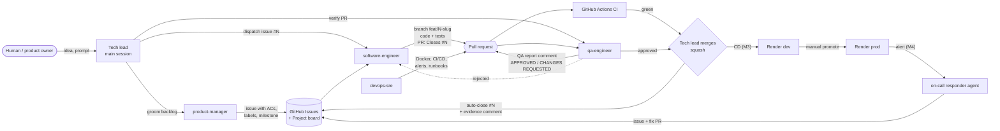

# Agent Team

EchoNotes is built by a small team of AI agents (Claude Code subagents) coordinated by a tech lead. The agent definitions live in [`.claude/agents/`](../.claude/agents/). All work goes through the public [GitHub issue tracker](https://github.com/mrfmanuel/EchoNotes/issues), so every step leaves evidence: comments, branches, PRs and QA reports.

## Roles

| Agent | File | Owns | Never does | Label |
|---|---|---|---|---|
| **Tech lead / orchestrator** | main Claude Code session | Plans each prompt, dispatches agents, resolves conflicts, merges PRs when QA and CI are green | Merges a PR with red CI or without a QA report | — |
| **Product Manager** | [`product-manager.md`](../.claude/agents/product-manager.md) | `docs/product-spec.md`, `openapi.yaml`, backlog grooming, acceptance criteria, labels and milestones | Writes or edits application code | `agent:pm` |
| **Software Engineer** | [`software-engineer.md`](../.claude/agents/software-engineer.md) | Implements one issue per branch `feat/<N>-<slug>`, writes tests with the code, opens a PR with `Closes #N` | Merges its own PR, widens scope beyond the issue | `agent:swe` |
| **QA Engineer** | [`qa-engineer.md`](../.claude/agents/qa-engineer.md) | Independent verification against the acceptance criteria, runs the full suite, posts a QA report (approve/reject) | Pushes fixes to the branch under test | `agent:qa` |
| **DevOps / SRE** | [`devops-sre.md`](../.claude/agents/devops-sre.md) | Docker, CI/CD, Render dev/prod, rollback, OpenTelemetry, alerts, runbooks, on-call responder | Ships infra changes without a PR, puts secrets in the repo | `agent:devops` |
| **Human (Manuel)** | — | Product owner: approves the spec, provides credentials (Groq, Render), spot-checks the deployed app, submits the project | — | — |

## Workflow

### Step by step

1. **Groom.** The tech lead asks the `product-manager` to turn a need into an issue (or to refine an existing one). The issue gets Context, an Acceptance criteria checklist, a Definition of done, a Spec link, labels (`type:*`, `area:*`, `agent:*`) and a milestone. The PM comments *"Groomed — ready for software-engineer."*
2. **Implement.** The tech lead dispatches the `software-engineer` (or `devops-sre` for infra) with exactly one issue number. The agent creates `feat/<N>-<slug>`, comments "Started…" on the issue, implements code and tests, runs the local checks, pushes, and opens a PR whose body contains `Closes #N`.
3. **CI.** GitHub Actions runs lint, type checks, tests and the build on the PR. The engineer fixes anything red (`gh pr checks --watch`).
4. **Verify.** The tech lead dispatches the `qa-engineer` with the PR number. QA checks out the branch, runs the suite, maps every acceptance criterion to evidence, and posts a QA report comment with the verdict.
5. **Merge.** If CI is green **and** QA approved, the tech lead squash-merges (`gh pr merge --squash --delete-branch`). The `Closes #N` keyword closes the issue. If QA rejects, the PR goes back to step 2 with the QA comment as input.
6. **Evidence.** The closed issue links to its PR, the QA report and the CI run. For work done outside a PR (docs-only changes on `main`), the tech lead closes the issue with a comment that lists what was done and the commit SHA.
7. **Deploy** (from M3). Merging to `main` deploys to **dev** automatically. The `devops-sre` (or the human) promotes to **prod** manually. See [release-process.md](release-process.md).
8. **Operate** (from M4). A user-impact alert wakes the on-call responder agent, which diagnoses the problem with the runbook, opens an incident issue and, when it can, opens a fix PR that goes through the same QA/CI gate. See [observability.md](observability.md).

## How the tech lead dispatches agents

The main session invokes subagents by name with Claude Code's Agent tool, always passing the issue or PR number and the expected output:

| Situation | Dispatch prompt (example) |
|---|---|
| New feature idea | `product-manager`: "Create an issue for US-13 (paste screenshot), milestone M2 App, with ACs from the spec." |
| Groomed issue | `software-engineer`: "Implement issue #14 following your workflow. Report the PR URL." |
| PR opened, CI green | `qa-engineer`: "Verify PR #31 against issue #14. Post your QA report on the PR. Report the verdict." |
| Infra issue | `devops-sre`: "Implement issue #27 (Render dev deploy). Open a PR with Closes #27." |

Independent issues may be dispatched in parallel (for example, backend and frontend stories in separate branches). Issues that depend on each other are dispatched in sequence.

## Hand-off contracts

| From → To | Artifact | Must contain |
|---|---|---|
| PM → SWE | GitHub issue | Context, AC checklist, DoD, spec link, labels, milestone |
| SWE → QA | Pull request | `Closes #N`, summary, test evidence, screenshots for UI, green CI |
| QA → Tech lead | PR comment | Verdict, AC table with evidence, test counts, CI status |
| Tech lead → Tracker | Merge / closing comment | Linked PR or commit SHA, what was done |
| DevOps → Everyone | Docs + runbooks | How to deploy, roll back and respond to each alert |
