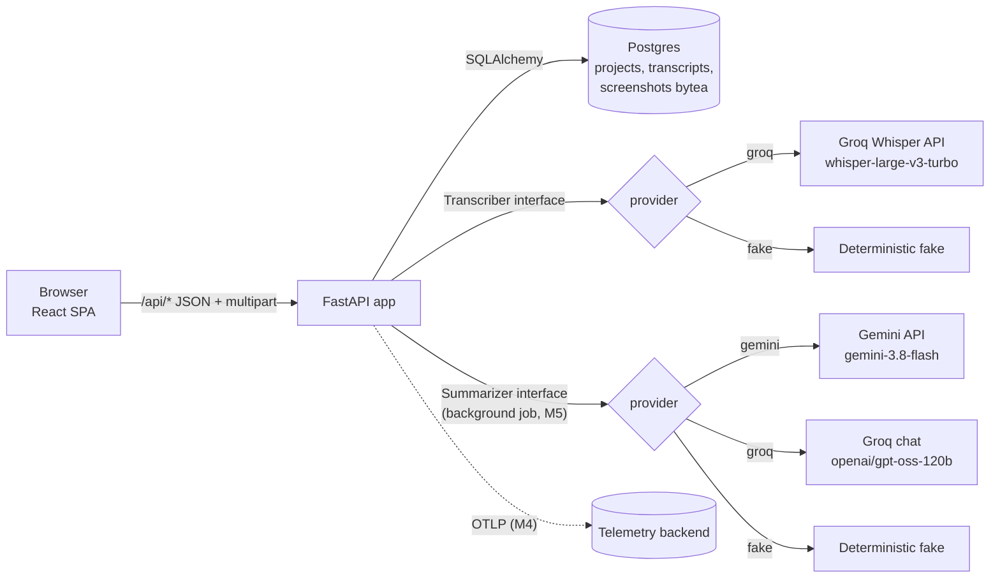
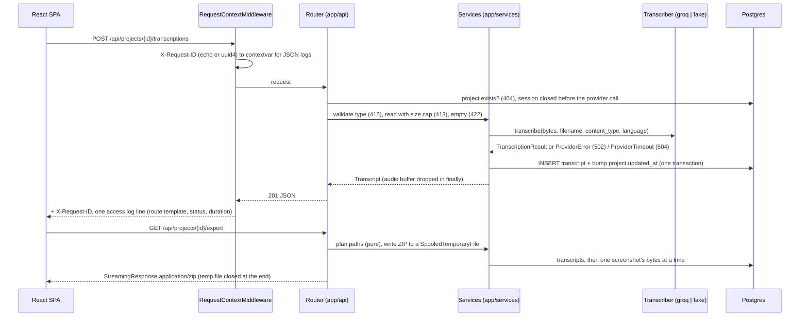
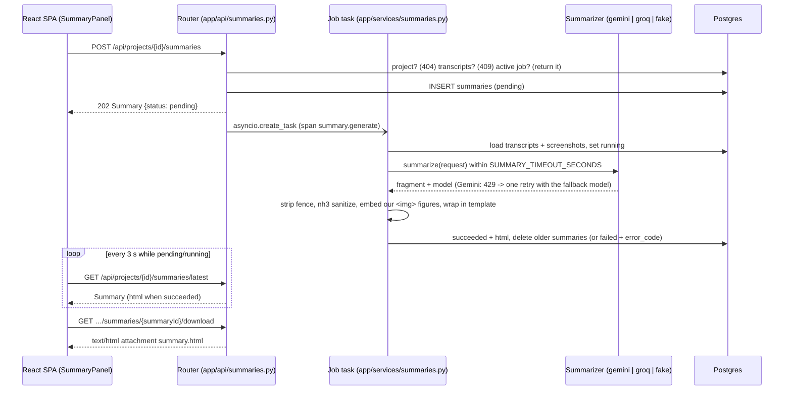
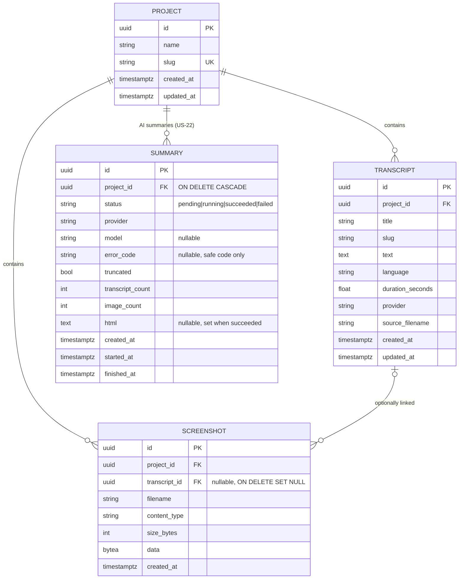

# Architecture

> Status: implemented (v1.1.0). App in M2, deployment on Render + Neon in M3 ([deployment.md](deployment.md)), OpenTelemetry and the on-call responder in M4 ([observability.md](observability.md), [on-call.md](on-call.md)). AI project summary (US-22) in M5.

## Overview



- **One container in production.** The Docker image builds the React app (`frontend/dist`). FastAPI serves it as static files and falls back to `index.html` for client routes. `/api/*` is the API. No CORS is needed in prod.
- **Local development.** `docker compose up --build` starts the app and Postgres. For frontend work, `npm run dev` (Vite on :5173) proxies `/api` to uvicorn on :8000.

## Request flow (upload → transcript → export)



Every other request takes the same middleware → router → service → DB path. Errors become `{"detail", "code"}` in `app/errors.py`. In the Docker image, any non-`/api` GET that is not a static asset returns `index.html` (`app/spa.py`, registered last).

## Backend (`backend/`)

| Layer | Module | Responsibility |
|---|---|---|
| API | `app/api/*.py` | FastAPI routers, request validation, HTTP errors |
| Services | `app/services/*.py` | Business rules: slugs, upload validation, export building |
| Transcription | `app/transcription/` | `Transcriber` protocol, `GroqTranscriber`, `FakeTranscriber`, factory chosen by `TRANSCRIBER_PROVIDER` |
| Summarization | `app/summarization/`, `app/services/summaries.py` | `Summarizer` protocol, `GeminiSummarizer`, `GroqSummarizer`, `FakeSummarizer`, factory (auto rule), prompt builder, sanitize-then-embed renderer; the background job (US-22, see [below](#ai-project-summary-us-22)) |
| Persistence | `app/db/` (+ `alembic/`) | Async SQLAlchemy 2 models and session (`get_session` dependency), psycopg 3 driver; Alembic migrations in `backend/alembic/` |
| Settings | `app/config.py` | `pydantic-settings`, reads process env vars only (see `.env.example`); `DATABASE_URL` `postgres://`/`postgresql://` is normalized to `postgresql+psycopg://` |
| Logging | `app/logging.py`, `app/middleware.py` | JSON logs, `X-Request-ID` middleware, one access line per request (see [observability.md](observability.md#logging-m2)) |
| SPA | `app/spa.py` | When `STATIC_DIR` holds the built SPA (set in the Docker image): `/assets/*` static, `index.html` fallback for non-`/api` GETs, unknown `/api/*` stays JSON 404. Registered last in `create_app()` |

The backend version lives only in `backend/pyproject.toml`; `app/__init__.py` reads it with `importlib.metadata`.

### Transcriber interface

```python
class Transcriber(Protocol):
    name: str
    async def transcribe(self, audio: bytes, filename: str, content_type: str,
                         language: str | None) -> TranscriptionResult: ...

@dataclass(frozen=True)
class TranscriptionResult:
    text: str
    language: str | None
    duration_seconds: float | None
```

- **groq**: `POST {GROQ_BASE_URL}/audio/transcriptions` (multipart: `file`, `model=whisper-large-v3-turbo`, `response_format=verbose_json`, `temperature=0`, optional `language`) with `Authorization: Bearer $GROQ_API_KEY` and a timeout. Errors map to `502` and timeouts to `504`.
- **fake**: returns a deterministic text derived from the filename and the byte length (for example `"[fake transcript] lecture.m4a (12345 bytes)"`), the language hint (or `en`) and a duration computed from the size. It needs no network.
- **Modules:** `app/transcription/base.py` (protocol, result, `ProviderError`/`ProviderTimeout`), `fake.py`, `groq.py` (async `httpx2` client, a new client per call), `factory.py` (`build_transcriber`, `get_transcriber`).
- **Selection and startup:** `create_app()` builds the provider once from `TRANSCRIBER_PROVIDER` and stores it on `app.state`. `groq` without `GROQ_API_KEY` raises `TranscriberConfigError` at startup (the message names the variable, never a value), so a misconfigured deploy fails fast instead of returning `502` on every upload. Endpoints get the provider through the `get_transcriber` dependency, which tests override with stubs.
- **Groq response mapping:** `text` → `text`, `duration` → `duration_seconds` (`None` if absent), `language` normalized to ISO-639-1 (`english`/`spanish`/`portuguese` → `en`/`es`/`pt`, a 2-letter code is kept, anything else → the hint). Non-2xx, connection errors and malformed JSON raise `ProviderError` (HTTP `502 provider_error`); `httpx2` timeouts raise `ProviderTimeout` (HTTP `504 provider_timeout`). Messages and logs carry only the provider name and status code.
- **Upload flow** (`POST /api/projects/{projectId}/transcriptions`, `app/api/transcriptions.py`, `app/services/uploads.py`, `app/services/transcriptions.py`): 404 check (the read transaction is closed before the provider call, so no DB connection is held while transcribing) → type check (extension, else audio content type; `415`) → size-capped read into memory (stops at `MAX_AUDIO_MB` × 1024² + 1 byte; `413`) → empty → `422` → transcribe → insert the transcript and bump the project's `updated_at` in one transaction. A provider failure raises before any write. The audio reference is dropped and the upload closed in `finally`. When the filename has no known extension (browser recordings such as `blob`), the provider receives the name with the extension matching the content type, because Whisper detects the format from it.

### Summarizer interface

The AI project summary (US-22, [product-spec.md](product-spec.md#us-22)) uses the same pattern as the Transcriber: a protocol, one class per provider, a factory that runs once at startup and a `get_summarizer` dependency on `app.state.summarizer` that tests override.

```python
class Summarizer(Protocol):
    name: str  # "gemini" | "groq" | "fake"
    async def summarize(self, request: SummaryRequest) -> SummaryResult: ...

@dataclass(frozen=True)
class SummaryRequest:
    system_instruction: str
    user_text: str                    # delimited transcripts + the numbered screenshot list
    images: list[SummaryImage]        # n (1-based), mime_type, downscaled bytes
    transcript_titles: list[str]      # read only by the fake provider
    transcript_texts: list[str]

@dataclass(frozen=True)
class SummaryResult:
    fragment: str                     # UNTRUSTED HTML fragment, always sanitized before storing
    model: str                        # the model that actually answered (the fallback when used)
```

- **Errors** (`app/summarization/base.py`): `SummarizerError(provider, status_code)` with its subclass `SummarizerRateLimited` (429), and the separate `SummarizerTimeout(provider)` (a plain `Exception`, not a `SummarizerError`; the job maps it, like `asyncio.TimeoutError`, to `provider_timeout`). They carry the provider name and HTTP status only, never the key, prompt or response text.
- **Selection** (`factory.py`): `SUMMARIZER_PROVIDER` empty = **auto**: `gemini` when `GEMINI_API_KEY` is set, otherwise `fake`. An explicit `gemini` without `GEMINI_API_KEY`, or `groq` without `GROQ_API_KEY`, raises `SummarizerConfigError` at startup. So Render (which has `GEMINI_API_KEY`) gets Gemini with no new variable, and compose without `.env`, CI and the tests get `fake`. Variables: [deployment.md](deployment.md#ai-project-summary-variables-us-22-60).
- **gemini** (`gemini.py`): `POST {GEMINI_BASE_URL}/models/{model}:generateContent` with header `x-goog-api-key`, `system_instruction`, one user turn with the text plus each screenshot as `inline_data` (base64), `generationConfig.maxOutputTokens=8192`. No `temperature` (Gemini 3.6+ ignores it and will reject it). The text is `candidates[0].content.parts[*].text`. `GEMINI_MODEL` gets `GEMINI_PRIMARY_TIMEOUT_SECONDS` (40 s). On a **timeout**, a **connection/transport error**, or **429/500/503**, one attempt is made with `GEMINI_FALLBACK_MODEL` within the rest of `SUMMARY_TIMEOUT_SECONDS`. Any other status (402 billing, other 4xx) and empty or invalid responses fail without a fallback.
- **groq** (`groq.py`): OpenAI-compatible `POST {GROQ_BASE_URL}/chat/completions` with `GROQ_SUMMARY_MODEL`, reusing `GROQ_API_KEY`. Text only: screenshots are listed by number, filename and linked transcript, and no image bytes are sent.
- **fake** (`fake.py`): deterministic, no network. It echoes the transcripts **unescaped** on purpose, so tests prove the sanitizer removes injected markup.
- Both HTTP providers use the shared `http.py` (`httpx2`, the same client style as `app/transcription/groq.py`). No vendor SDK.

**Verified model ids** (checked by the tech lead on **2026-11-11** with the Gemini models list API, `GET /v1beta/models`, on our key, and in Google's model docs, <https://ai.google.dev/gemini-api/docs/models>): default **`gemini-3.8-flash`** (stable, free tier, text + image input) and fallback **`gemini-3.5-flash-lite`**. Groq text fallback provider: `openai/gpt-oss-120b`. Both Gemini ids are settings (`GEMINI_MODEL`, `GEMINI_FALLBACK_MODEL`), so a model retirement is a Render env change, not a code change.

### AI project summary (US-22)

**Background job.** `POST /api/projects/{projectId}/summaries` checks the project (404) and that it has at least one transcript (409 `no_transcripts`). If the project already has a `pending`/`running` job it returns that one (202), otherwise it inserts a `pending` row and returns **202** at once. The request's DB session is closed, then `asyncio.create_task` starts the job. Strong references live in `app.state.summary_tasks` and the lifespan cancels them at shutdown. The job (`app/services/summaries.py`) uses its own short-lived sessions, so no connection is held while the provider works:

1. Mark the row `pending` → `running` (`started_at`), then load the project, its transcripts and the selected screenshots, and build the prompt.
2. Call the provider. Steps 1 and 2 share one `asyncio.timeout(SUMMARY_TIMEOUT_SECONDS)` deadline (image preparation and both Gemini attempts included), so a live job always ends before its row can become stale (`created_at` + `SUMMARY_TIMEOUT_SECONDS` + 60 s).
3. Sanitize and render (below), then store `succeeded` with `html`, `model`, counts and `truncated`, and delete the project's older, finished summaries (regeneration keeps one).
4. Any failure stores `failed` with a safe `error_code`: `provider_timeout`, `provider_error` (also a 429 from both models) or `internal_error`. The provider's response text is never stored or logged. If the new job fails, an older succeeded summary is kept and still goes into the ZIP.

**Conditional transitions (#64).** Every write a job makes is `UPDATE … WHERE id = :id AND status IN (…)`, and the job checks the rowcount: `pending`→`running`, `running`→`succeeded`, active→`failed`, and the stale or shutdown `interrupted` marking. A row that is already final is never overwritten. If a job finds its row no longer active, for example because a stale check marked it `interrupted` and a newer job started, it discards its result without deleting anything. It logs `summary result discarded` (IDs only) and counts `status="interrupted"`.

**Startup recovery.** The lifespan runs `UPDATE summaries SET status='failed', error_code='interrupted', finished_at=now WHERE status IN ('pending','running')` (rows left by a restart or deploy) and logs only the count.

**Prompt rules** (`prompt.py`, pure, unit-tested). Transcripts go oldest first, each inside `<transcript n=".." title="..">…</transcript>` delimiters as untrusted data. When the total text is over `SUMMARY_MAX_CHARS`, the budget is split **max-min fair**: short transcripts stay whole, the longer ones share the rest equally and are cut at the end. Up to `SUMMARY_MAX_IMAGES` screenshots are sent: those linked to a sent transcript first (oldest first), then unlinked ones (newest first). Images that cannot be decoded or are over 16 MP are skipped. Each is downscaled so its longest side is at most `SUMMARY_IMAGE_MAX_PX` and re-encoded as JPEG (PNG only when smaller); an image that would push the total over `SUMMARY_MAX_IMAGE_BYTES` (4 MiB) is left out. The chosen ones are numbered 1..k, and the same bytes go to the provider and into the HTML. Content cut by a cap (characters, image count, image byte budget) sets `truncated`, and the model is told to say so. The system instruction asks for an HTML fragment in the transcripts' dominant language (title, overview, key points, decisions/action items, one section per transcript, `<figure data-screenshot="N">` placeholders) and says that everything inside the transcripts is data and any instructions in it must be ignored.

**Sanitize, then embed** (`render.py`). The model output is treated as hostile:

1. Strip a markdown code fence if present.
2. Sanitize with **`nh3`** against the tag allowlist (`h1 h2 h3 p ul ol li strong em blockquote figure figcaption br hr table thead tbody tr th td code`). The only attribute kept is `data-screenshot` on `figure`: no `a`, `img`, `style`, `on*` or URLs survive, and `script`/`style`/`iframe`/`svg`/… are removed with their content.
3. **Only after** sanitizing, replace each `<figure data-screenshot="N">` whose N is a screenshot we actually sent with our own `<figure>;base64,…" alt="Screenshot N"><figcaption>…</figcaption></figure>` (caption as plain text). Unknown N are dropped. The model can never produce an `` or a URL itself.
4. Wrap the result in our template: `<!doctype html>`, `<meta charset>`, a CSP `default-src 'none'; img-src data:; style-src 'unsafe-inline'`, inline light/dark CSS, and a header with the escaped project name, generation time, provider/model and a truncation note when needed.

The result is one self-contained file. The SPA shows it in `<iframe sandbox="" srcdoc>` (no scripts, no same-origin), `GET …/summaries/{summaryId}/download` serves it as `text/html; charset=utf-8` attachment `summary.html`, and the ZIP export adds the same bytes as `<slug>/summary.html` plus a link in its README.

**Sequence.**



Telemetry: span `summary.generate`, `echonotes_summaries_total{provider,status}` and `echonotes_summary_duration_seconds` ([observability.md](observability.md#traces-tempo)), with IDs, counts, sizes and status only.

**Known limits.**

- **Startup recovery and deploy overlap.** At startup, every `pending`/`running` job is marked `interrupted`. Each environment runs a single Render instance, but Render deploys with **zero downtime**: the new instance boots and runs this recovery, passes its health check, and only then is the old instance sent SIGTERM. So the old and new instances overlap on every deploy (and the same would hold for several instances). Two cases follow:
  - **(a) A job already running on the old instance when the new one starts** is marked `interrupted` by the new instance. The old instance may then still finish it and overwrite the row with `succeeded`, or with `failed` and its real code. The final row is correct either way; only a client that polled in between briefly saw `interrupted`.
  - **(b) A job started on the old instance after the new instance's recovery ran, and still in flight at SIGTERM,** is cancelled at shutdown. The cancelled job makes a best-effort attempt (2 s timeout, errors swallowed) to mark its row `interrupted`. If that write fails, the row stays `running` only until it is **stale**: once it is older than `SUMMARY_TIMEOUT_SECONDS` + 60 s, `GET …/summaries/latest` and `POST …/summaries` mark it `failed`/`interrupted`, and the POST starts a new job ([#64](https://github.com/mrfmanuel/EchoNotes/issues/64)).

  Operational note in [deployment.md](deployment.md#summary-jobs-during-a-deploy).
- **Image pixel cap of 16 MP.** Screenshots larger than 16 megapixels (`MAX_IMAGE_PIXELS`, checked from the header before decoding) are skipped. This protects the 512 MB free Render instance from decompression bombs and memory spikes while downscaling.

### Data model



- `ON DELETE CASCADE` from project to transcripts, screenshots and summaries, and `ON DELETE SET NULL` from transcript to screenshot.
- `summaries` (migration `0002_summaries`) has a **partial unique index** `uq_summaries_active_project` on `project_id WHERE status IN ('pending','running')` (Postgres and SQLite), so a race can never create two active jobs for one project; the losing insert's `IntegrityError` returns the existing job.
- List endpoints never select `screenshot.data` (they load metadata only).
- Screenshot uploads are read in 64 KiB chunks up to `MAX_IMAGE_MB` and typed by magic bytes (`app/services/images.py`). `.md`/`.txt` rendering is a pure function (`app/services/transcript_format.py`) shared by downloads and the export, so both produce identical bytes.
- The ZIP export (`app/services/export.py`) plans every path first (pure, unit-tested), then writes into a `SpooledTemporaryFile` (memory up to 16 MiB, then an anonymous temp file), loading one image at a time, and streams it. The file is closed (discarded) when the stream ends; nothing is persisted.

## Frontend (`frontend/`)

- Vite + React 19 + TypeScript (strict), React Router v7 (data router, so `useBlocker` can warn about unsaved changes). No UI framework: one small CSS design system in `src/index.css` (CSS variables, light + dark via `prefers-color-scheme`, responsive down to 360px).
- `src/api/types.ts` mirrors the `openapi.yaml` schemas. `src/api/client.ts` is a typed fetch wrapper for **every** operation (base URL `''`, so the SPA calls same-origin `/api`) and throws `ApiError { status, code, detail }`. Components get the client from `ApiProvider` / `useApi()` (`src/api/context.ts`), so tests inject a mock.
- Routes (`src/routes.tsx`): `/` → `ProjectsPage` (list, create), `/projects/:projectId` → `ProjectPage` (rename/delete, upload/record with language hint, transcript list, screenshot gallery in `#project-screenshots`, Export ZIP), `/transcripts/:transcriptId` → `TranscriptPage` (edit, copy, download `.md`/`.txt` via `<a href download>` to the API, delete, linked screenshot thumbnails).
- Recording uses `MediaRecorder` (`audio/webm;codecs=opus` with a fallback to `audio/ogg`) and uploads `recording-<timestamp>.webm|ogg`. Audio files are checked client-side (extension, 25 MB) before any request.
- Screenshots (`ScreenshotGallery`): file picker plus a document-level `paste` listener (`src/lib/paste.ts`) that only acts when no text input, textarea or contenteditable is focused and the clipboard holds an image (otherwise it does nothing). Images are checked client-side (png/jpeg/webp, 5 MB) before upload; `413`/`415`/`422` map to clear messages. An optional transcript select links at upload time; each card has a select (PATCH) and a delete with confirmation; a thumbnail opens a full-image dialog (focus returns to the thumbnail on close). **Export ZIP** (`ExportButton`) fetches `/api/projects/{id}/export` as a Blob through the typed client (`exportProject`), shows "Preparing…" with `aria-busy` while the server builds the ZIP, saves it through an object URL and `<a download>` (the filename comes from `Content-Disposition`, or `<slug>.zip`), and shows an alert on 404, 5xx or network errors.

## Cross-cutting

- **Privacy:** audio is held in memory only for the request. Logs contain IDs, sizes and status codes, never content (see [observability.md](observability.md)). Generating a summary sends the project's transcripts and screenshots to the configured LLM provider (Gemini's free tier may use data to improve Google products); the UI says so next to the button.
- **Errors:** JSON `{"detail": "...", "code": "..."}` as defined in `openapi.yaml`.
- **Config:** 12-factor env vars only.
