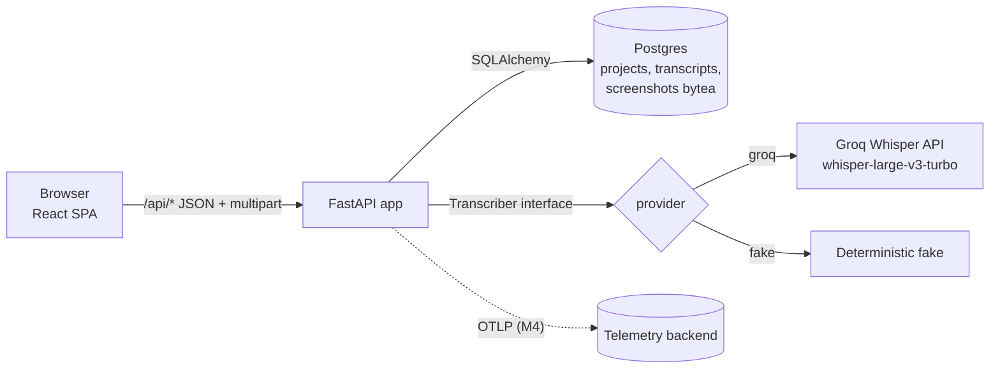
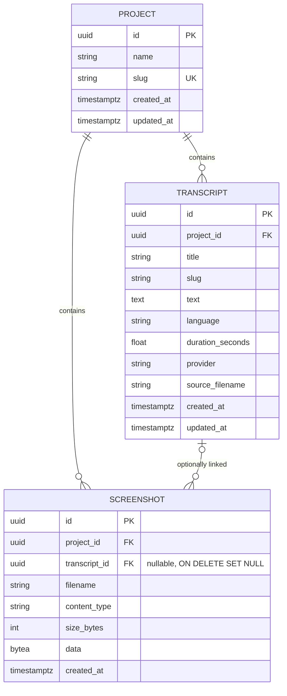

# Architecture

> Status: target architecture agreed in M1. The skeleton (health endpoint and placeholder page) exists. Features arrive in M2.

## Overview



- **One container in production.** The Docker image builds the React app (`frontend/dist`). FastAPI serves it as static files and falls back to `index.html` for client routes. `/api/*` is the API. No CORS is needed in prod.
- **Local development.** `docker compose up --build` starts the app and Postgres. For frontend work, `npm run dev` (Vite on :5173) proxies `/api` to uvicorn on :8000.

## Backend (`backend/`)

| Layer | Module (planned) | Responsibility |
|---|---|---|
| API | `app/api/*.py` | FastAPI routers, request validation, HTTP errors |
| Services | `app/services/*.py` | Business rules: slugs, upload validation, export building |
| Transcription | `app/transcription/` | `Transcriber` protocol, `GroqTranscriber`, `FakeTranscriber`, factory chosen by `TRANSCRIBER_PROVIDER` |
| Persistence | `app/db/` | SQLAlchemy 2 models, session, Alembic migrations |
| Settings | `app/config.py` | `pydantic-settings`, reads env vars (see `.env.example`) |

### Transcriber interface

```python
class Transcriber(Protocol):
    name: str
    async def transcribe(self, audio: bytes, filename: str, content_type: str,
                         language: str | None) -> TranscriptionResult: ...

@dataclass(frozen=True)
class TranscriptionResult:
    text: str
    language: str | None
    duration_seconds: float | None
```

- **groq**: `POST {GROQ_BASE_URL}/audio/transcriptions` (multipart: `file`, `model=whisper-large-v3-turbo`, `response_format=verbose_json`, `temperature=0`, optional `language`) with `Authorization: Bearer $GROQ_API_KEY` and a timeout. Errors map to `502` and timeouts to `504`.
- **fake**: returns a deterministic text derived from the filename and the byte length (for example `"[fake transcript] lecture.m4a (12345 bytes)"`), the language hint (or `en`) and a duration computed from the size. It needs no network.

### Data model



- `ON DELETE CASCADE` from project to transcripts and screenshots, and `ON DELETE SET NULL` from transcript to screenshot.
- List endpoints never select `screenshot.data` (they load metadata only).

## Frontend (`frontend/`)

- Vite + React 18 + TypeScript, React Router, plain CSS modules (no UI framework, to keep it small).
- `src/api/client.ts` is a typed fetch wrapper that follows `openapi.yaml`.
- Pages: `ProjectsPage`, `ProjectPage` (upload/record, transcript list, screenshot gallery and paste handler) and `TranscriptPage` (edit, copy, download).
- Recording uses `MediaRecorder` (`audio/webm;codecs=opus` with a fallback to `audio/ogg`).

## Cross-cutting

- **Privacy:** audio is held in memory only for the request. Logs contain IDs, sizes and status codes, never content (see [observability.md](observability.md)).
- **Errors:** JSON `{"detail": "...", "code": "..."}` as defined in `openapi.yaml`.
- **Config:** 12-factor env vars only.
