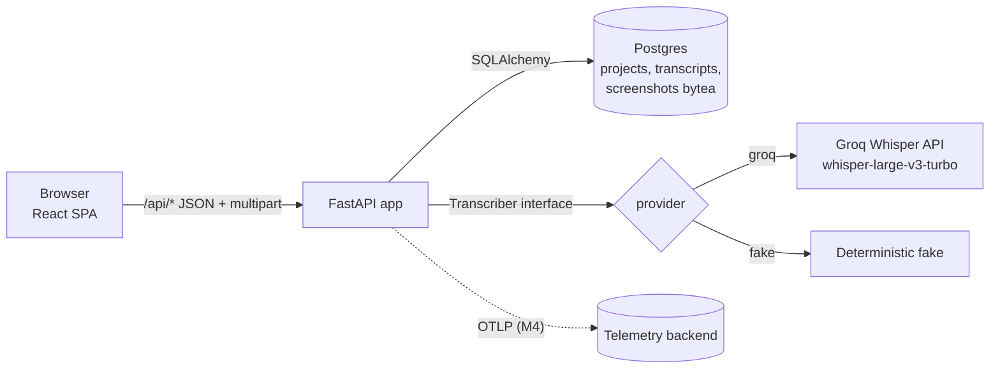
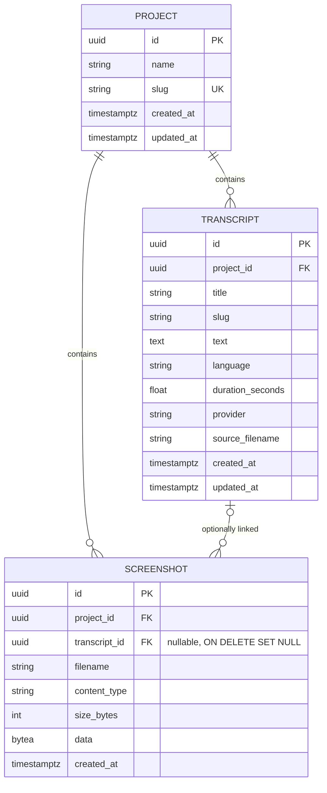

# Architecture

> Status: target architecture agreed in M1. The skeleton (health endpoint and placeholder page) exists. Features arrive in M2.

## Overview



- **One container in production.** The Docker image builds the React app (`frontend/dist`). FastAPI serves it as static files and falls back to `index.html` for client routes. `/api/*` is the API. No CORS is needed in prod.
- **Local development.** `docker compose up --build` starts the app and Postgres. For frontend work, `npm run dev` (Vite on :5173) proxies `/api` to uvicorn on :8000.

## Backend (`backend/`)

| Layer | Module (planned) | Responsibility |
|---|---|---|
| API | `app/api/*.py` | FastAPI routers, request validation, HTTP errors |
| Services | `app/services/*.py` | Business rules: slugs, upload validation, export building |
| Transcription | `app/transcription/` | `Transcriber` protocol, `GroqTranscriber`, `FakeTranscriber`, factory chosen by `TRANSCRIBER_PROVIDER` |
| Persistence | `app/db/` (+ `alembic/`) | Async SQLAlchemy 2 models and session (`get_session` dependency), psycopg 3 driver; Alembic migrations in `backend/alembic/` |
| Settings | `app/config.py` | `pydantic-settings`, reads process env vars only (see `.env.example`); `DATABASE_URL` `postgres://`/`postgresql://` is normalized to `postgresql+psycopg://` |
| Logging | `app/logging.py`, `app/middleware.py` | JSON logs, `X-Request-ID` middleware, one access line per request (see [observability.md](observability.md#logging-m2)) |
| SPA | `app/spa.py` | When `STATIC_DIR` holds the built SPA (set in the Docker image): `/assets/*` static, `index.html` fallback for non-`/api` GETs, unknown `/api/*` stays JSON 404. Registered last in `create_app()` |

The backend version lives only in `backend/pyproject.toml`; `app/__init__.py` reads it with `importlib.metadata`.

### Transcriber interface

```python
class Transcriber(Protocol):
    name: str
    async def transcribe(self, audio: bytes, filename: str, content_type: str,
                         language: str | None) -> TranscriptionResult: ...

@dataclass(frozen=True)
class TranscriptionResult:
    text: str
    language: str | None
    duration_seconds: float | None
```

- **groq**: `POST {GROQ_BASE_URL}/audio/transcriptions` (multipart: `file`, `model=whisper-large-v3-turbo`, `response_format=verbose_json`, `temperature=0`, optional `language`) with `Authorization: Bearer $GROQ_API_KEY` and a timeout. Errors map to `502` and timeouts to `504`.
- **fake**: returns a deterministic text derived from the filename and the byte length (for example `"[fake transcript] lecture.m4a (12345 bytes)"`), the language hint (or `en`) and a duration computed from the size. It needs no network.
- **Modules:** `app/transcription/base.py` (protocol, result, `ProviderError`/`ProviderTimeout`), `fake.py`, `groq.py` (async `httpx2` client, a new client per call), `factory.py` (`build_transcriber`, `get_transcriber`).
- **Selection and startup:** `create_app()` builds the provider once from `TRANSCRIBER_PROVIDER` and stores it on `app.state`. `groq` without `GROQ_API_KEY` raises `TranscriberConfigError` at startup (the message names the variable, never a value), so a misconfigured deploy fails fast instead of returning `502` on every upload. Endpoints get the provider through the `get_transcriber` dependency, which tests override with stubs.
- **Groq response mapping:** `text` → `text`, `duration` → `duration_seconds` (`None` if absent), `language` normalized to ISO-639-1 (`english`/`spanish`/`portuguese` → `en`/`es`/`pt`, a 2-letter code is kept, anything else → the hint). Non-2xx, connection errors and malformed JSON raise `ProviderError` (HTTP `502 provider_error`); `httpx2` timeouts raise `ProviderTimeout` (HTTP `504 provider_timeout`). Messages and logs carry only the provider name and status code.
- **Upload flow** (`POST /api/projects/{projectId}/transcriptions`, `app/api/transcriptions.py`, `app/services/uploads.py`, `app/services/transcriptions.py`): 404 check (the read transaction is closed before the provider call, so no DB connection is held while transcribing) → type check (extension, else audio content type; `415`) → size-capped read into memory (stops at `MAX_AUDIO_MB` × 1024² + 1 byte; `413`) → empty → `422` → transcribe → insert the transcript and bump the project's `updated_at` in one transaction. A provider failure raises before any write. The audio reference is dropped and the upload closed in `finally`. When the filename has no known extension (browser recordings such as `blob`), the provider receives the name with the extension matching the content type, because Whisper detects the format from it.

### Data model



- `ON DELETE CASCADE` from project to transcripts and screenshots, and `ON DELETE SET NULL` from transcript to screenshot.
- List endpoints never select `screenshot.data` (they load metadata only).
- Screenshot uploads are read in 64 KiB chunks up to `MAX_IMAGE_MB` and typed by magic bytes (`app/services/images.py`). `.md`/`.txt` rendering is a pure function (`app/services/transcript_format.py`) shared by downloads and the export, so both produce identical bytes.
- The ZIP export (`app/services/export.py`) plans every path first (pure, unit-tested), then writes into a `SpooledTemporaryFile` (memory up to 16 MiB, then an anonymous temp file), loading one image at a time, and streams it. The file is closed (discarded) when the stream ends; nothing is persisted.

## Frontend (`frontend/`)

- Vite + React 19 + TypeScript (strict), React Router v7 (data router, so `useBlocker` can warn about unsaved changes). No UI framework: one small CSS design system in `src/index.css` (CSS variables, light + dark via `prefers-color-scheme`, responsive down to 360px).
- `src/api/types.ts` mirrors the `openapi.yaml` schemas. `src/api/client.ts` is a typed fetch wrapper for **every** operation (base URL `''`, so the SPA calls same-origin `/api`) and throws `ApiError { status, code, detail }`. Components get the client from `ApiProvider` / `useApi()` (`src/api/context.ts`), so tests inject a mock.
- Routes (`src/routes.tsx`): `/` → `ProjectsPage` (list, create), `/projects/:projectId` → `ProjectPage` (rename/delete, upload/record with language hint, transcript list, screenshot gallery in `#project-screenshots`, Export ZIP), `/transcripts/:transcriptId` → `TranscriptPage` (edit, copy, download `.md`/`.txt` via `<a href download>` to the API, delete, linked screenshot thumbnails).
- Recording uses `MediaRecorder` (`audio/webm;codecs=opus` with a fallback to `audio/ogg`) and uploads `recording-<timestamp>.webm|ogg`. Audio files are checked client-side (extension, 25 MB) before any request.
- Screenshots (`ScreenshotGallery`): file picker plus a document-level `paste` listener (`src/lib/paste.ts`) that only acts when no text input, textarea or contenteditable is focused and the clipboard holds an image (otherwise it does nothing). Images are checked client-side (png/jpeg/webp, 5 MB) before upload; `413`/`415`/`422` map to clear messages. An optional transcript select links at upload time; each card has a select (PATCH) and a delete with confirmation; a thumbnail opens a full-image dialog (focus returns to the thumbnail on close). **Export ZIP** (`ExportButton`) fetches `/api/projects/{id}/export` as a Blob through the typed client (`exportProject`), shows "Preparing…" with `aria-busy` while the server builds the ZIP, saves it through an object URL and `<a download>` (the filename comes from `Content-Disposition`, or `<slug>.zip`), and shows an alert on 404, 5xx or network errors.

## Cross-cutting

- **Privacy:** audio is held in memory only for the request. Logs contain IDs, sizes and status codes, never content (see [observability.md](observability.md)).
- **Errors:** JSON `{"detail": "...", "code": "..."}` as defined in `openapi.yaml`.
- **Config:** 12-factor env vars only.
