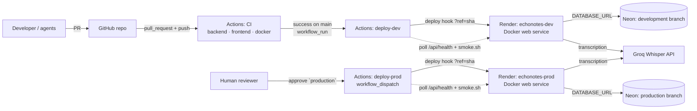

# Deployment

> Status: **live since P3 (M3 Deploy & CI/CD, 2026-11-10).** Prod: <https://echonotes-prod.onrender.com> · Dev: <https://echonotes-dev.onrender.com>

## Architecture



Render builds the image itself from the repo's root `Dockerfile` at the requested commit. GitHub Actions never builds or pushes the deployed image and never holds the database URLs or the Groq key: it only calls the deploy hooks and checks the public URLs.

## Environments

| Environment | URL | Render service | Database (Neon branch) | Transcriber | Deploy |
|---|---|---|---|---|---|
| local | <http://localhost:8000> | — (`docker compose up --build`) | Postgres 16 container | `fake` (default) | manual |
| dev | <https://echonotes-dev.onrender.com> | `echonotes-dev` (free) | `development` | `groq` | **automatic** after CI passes on `main` (`deploy-dev.yml`) |
| prod | <https://echonotes-prod.onrender.com> | `echonotes-prod` (free) | `production` | `groq` | **manual** promotion with approval (`deploy-prod.yml`, environment `production`) |

Render env vars per service (values live only in Render): `DATABASE_URL` (Neon connection string, `postgresql+psycopg://…?sslmode=require`), `APP_ENV` (`dev` / `prod`), `TRANSCRIBER_PROVIDER=groq`, `GROQ_API_KEY`. Render itself sets `PORT` and `RENDER_GIT_COMMIT`.

### GitHub secrets and variables (names only)

| Name | Kind | Used by |
|---|---|---|
| `RENDER_DEV_DEPLOY_HOOK` | repo secret | `deploy-dev.yml`, `rollback.yml` (dev) |
| `RENDER_PROD_DEPLOY_HOOK` | repo secret | `deploy-prod.yml`, `rollback.yml` (prod) |
| `DEV_URL` | repo variable | all deploy workflows (health, smoke, default prod ref) |
| `PROD_URL` | repo variable | `deploy-prod.yml`, `rollback.yml` |

GitHub environments: `development` (protected branches only) and `production` (required reviewer `mrfmanuel`, protected branches only). `main` is protected: the three CI jobs are required checks ([process.md](process.md#branch-protection-on-main-since-m3-48)).

### First-time setup (done once, manually by the human)

1. **Neon:** create project `echonotes` with two branches, `production` and `development` (separate databases, same schema history). Copy each branch's connection string and change the scheme to `postgresql+psycopg://`. Tables are created by Alembic on the first deploy; nothing is created by hand.
2. **Render:** create two **Web Services → Docker** from this repo, branch `main`, root `Dockerfile`, plan Free: `echonotes-dev` and `echonotes-prod`. Health check path `/api/health`. **Auto-Deploy: Off** (GitHub Actions decides what is deployed). Set the env vars above. Copy each service's **Deploy Hook** URL (Settings → Deploy Hook).
3. **Local file `.env.deploy`** (git-ignored by `.env.*`): `RENDER_DEV_DEPLOY_HOOK`, `RENDER_PROD_DEPLOY_HOOK`, `DEV_URL`, `PROD_URL`.
4. **GitHub (done by the tech lead agent with `gh`, P3):** secrets and variables loaded from `.env.deploy` without echoing (`… | gh secret set NAME`), environments created with `gh api -X PUT repos/<owner>/<repo>/environments/<name>`, branch protection with `gh api -X PUT …/branches/main/protection`.

### Free-tier caveats

- Free Render services **spin down after 15 minutes without traffic**; the next request cold-starts the container (~30–60 s; we measured ~34 s). The UI simply loads slowly the first time. `smoke.sh` and `deploy.sh` retry health for this reason.
- A deploy (Docker build on Render + start) took **46–63 s** in the P3 runs; `deploy.sh` allows 15 min.
- Neon free branches also suspend when idle; the first query after a pause adds a little latency. The health check's 2 s DB timeout has been enough so far.
- One Groq call (1 s silent clip) per deploy from the smoke test.

### Database migrations on deploy

The container entrypoint runs `alembic upgrade head` against the environment's Neon branch **before** uvicorn starts. If a migration fails, the container exits, Render's health check never passes, Render keeps the previous instance serving, and `deploy.sh` fails at "verify commit" (prod then rolls back automatically). Migrations must therefore be **backward compatible** (expand → migrate → contract), so that the previous app version still runs on the new schema after a rollback. Dev and prod migrate independently, each on its own deploy.

## Shared runtime notes

- A single image serves the FastAPI API and the built React SPA.
- Configuration comes from env vars only (`DATABASE_URL`, `TRANSCRIBER_PROVIDER`, `GROQ_API_KEY`, …). See `.env.example`.
- Migrations (`alembic upgrade head`) run on container start before uvicorn.
- After each deploy, `scripts/smoke.sh <service-url>` gates success: health (retried for cold starts) and the full key journey with a throwaway `smoke-test-*` project that is always deleted. Against a Groq-backed service set `SMOKE_ALLOW_EMPTY_TEXT=1` (silent audio may transcribe to nothing). Each smoke run makes one real Groq call on prod; no key is needed by the script.

## Local: docker compose (M2, #22)

```bash
docker compose up --build        # or: make up   -> http://localhost:8000
docker compose down              # stop, keep the database volume
docker compose down -v           # stop and wipe the database
```

- **No `.env` needed.** `docker-compose.yml` has safe defaults: `TRANSCRIBER_PROVIDER=fake`, Postgres user/password/db `echonotes`, and `DATABASE_URL` pointing at the `db` service. `.env` is loaded if it exists (`env_file` with `required: false`), e.g. to set `TRANSCRIBER_PROVIDER=groq` and `GROQ_API_KEY`.
- Values in the compose `environment:` block win over `.env`, so the host-oriented `DATABASE_URL=...@localhost:5432/...` and the empty `STATIC_DIR=` from `.env.example` do not affect the container.
- Services: `db` = `postgres:16` with the named volume `pgdata` and a `pg_isready` healthcheck (no host port). `app` = the root `Dockerfile`, starts after `db` is healthy, published on `8000:8000`.

## The image (`Dockerfile`)

| Stage | Base | Does |
|---|---|---|
| `frontend` | `node:24-slim` | `npm ci && npm run build` → `frontend/dist` |
| `backend` | `python:3.12-slim` + `uv` (pinned `ghcr.io/astral-sh/uv` tag) | `uv sync --frozen --no-dev` into `/app/.venv` (lockfile layer first for caching) |
| `runtime` | `python:3.12-slim` | venv + `alembic/` + SPA in `/app/static`; no Node, no uv, no dev deps, no `.env` |

- **Port:** uvicorn listens on `$PORT` (default `8000`). Render injects `PORT`; `docker run -e PORT=9000 -p 9000:9000 ...` also works.
- **Migrations on start:** `docker/entrypoint.sh` runs `alembic upgrade head` and then `exec uvicorn`. If the database is unreachable or a migration fails, the container exits non-zero (the deploy fails instead of serving a broken schema). Passing a command (`docker run  id -u`) runs that command instead.
- **Non-root:** runs as `echonotes` (uid 10001); app files are root-owned and read-only.
- **Health:** `HEALTHCHECK` runs `docker/healthcheck.py` (stdlib `urllib`, no curl) against `GET /api/health`; the container is `healthy` only on 200 (database reachable).
- **SPA:** `STATIC_DIR=/app/static` makes FastAPI serve `/assets/*` and fall back to `index.html` for any other non-`/api` GET (client routes like `/projects/<id>`). Unknown `/api/*` paths stay JSON 404. Without `STATIC_DIR` (dev, tests) the app serves the API only.
- **Proxy:** uvicorn trusts `X-Forwarded-*` (`--proxy-headers`, `FORWARDED_ALLOW_IPS=*`) because Render terminates TLS in front of the container.
- **Traceability:** the `GIT_SHA` build arg sets the `org.opencontainers.image.revision` label (CI passes `github.sha`) and the runtime `GIT_SHA` env var, which `GET /api/health` reports as `commit`. On Render the build arg is not passed; Render's runtime `RENDER_GIT_COMMIT` wins. Neither set → `"unknown"`. `environment` is `APP_ENV`. The UI footer shows `v<version> · <7-char commit> · <environment>` (#47).
- **CI:** the `docker` job in `ci.yml` builds the image on every PR (Buildx, GitHub Actions layer cache, no push), checks it is non-root, boots it with compose (`up -d --wait`) and runs `scripts/smoke.sh http://localhost:8000` (the whole key journey, see [testing.md](testing.md#end-to-end-smoke-test-scriptssmokesh-24)).

## CD workflows and `scripts/deploy.sh` (#25, #26, #27)

| Workflow | Trigger | GitHub environment | Does |
|---|---|---|---|
| `deploy-dev.yml` | `workflow_run` of **CI** succeeding on a push to `main` (+ `workflow_dispatch`, optional `ref`) | `development` | deploys exactly the commit CI tested |
| `deploy-prod.yml` | `workflow_dispatch` only (`ref`, empty = commit running on dev) | `production` (required reviewer) | records `previous_commit`, deploys, auto-rolls back to `previous_commit` on failure (run still fails) |
| `rollback.yml` | `workflow_dispatch` only (`environment` dev\|prod, `ref`) | `development` / `production` | redeploys a known-good commit on `main` |

None of them run for pull requests. Concurrency groups `deploy-dev` / `deploy-prod` are shared with `rollback.yml`, so deploys and rollbacks of one environment never overlap.

All three call the same script (no deploy logic in YAML):

```bash
DEPLOY_HOOK_URL=<hook> scripts/deploy.sh <dev|prod> <base-url> <full-40-char-sha>
scripts/resolve-commit.sh ref <short-or-full-sha>   # full SHA, must be on origin/main
scripts/resolve-commit.sh health <base-url>         # commit running there, or "unknown"
```

`deploy.sh`: triggers the Render deploy hook with `&ref=<sha>` (200 = started, 202 = another deploy in progress → retried with backoff up to `DEPLOY_HOOK_WAIT`=600 s, anything else fails), polls `/api/health` every 15 s until `commit == sha` (`DEPLOY_TIMEOUT`=900 s, 5xx/timeouts tolerated) and `environment` matches, then runs `SMOKE_ALLOW_EMPTY_TEXT=1 SMOKE_EXPECT_COMMIT=<sha> scripts/smoke.sh <base-url>`. It writes a job summary (env, URL, target, commit running before, deploy id, result, durations). The hook URL comes only from `DEPLOY_HOOK_URL`, is never printed and is masked in Actions. Smoke on dev/prod uses the service's real provider (Groq) with the 1 s silent clip: one Groq call per deploy, made by the service itself; CI never holds the Groq key.

Secrets / variables used: see [the table above](#github-secrets-and-variables-names-only). Tests: `bash scripts/tests/test_deploy.sh` ([testing.md](testing.md#deploy-script-tests-scriptsdeploysh-25-26-27)). Confirmed on the first live runs: the hook answers **200** with a deploy id, `RENDER_GIT_COMMIT` is the full 40-char SHA. The release flow, rollback and evidence are in [release-process.md](release-process.md).
