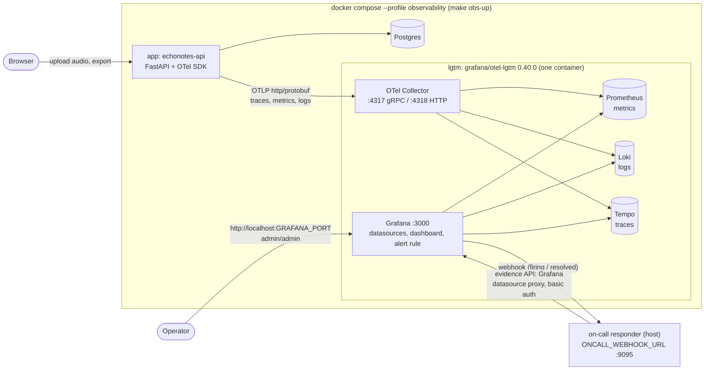

# Observability, Alerting and On-call

> Status: **local stack, dashboard and alert live since M4** ([#30](https://github.com/mrfmanuel/EchoNotes/issues/30), [#31](https://github.com/mrfmanuel/EchoNotes/issues/31)). Backend instrumentation: [#29](https://github.com/mrfmanuel/EchoNotes/issues/29). On-call responder: [#32](https://github.com/mrfmanuel/EchoNotes/issues/32), see [on-call.md](on-call.md). Stories: [US-18 … US-21](product-spec.md#us-18), [NFR-Observability](product-spec.md#nfr-observability). Design: [`prompts/P4-observability-oncall.md`](../prompts/P4-observability-oncall.md).

| Piece | Where | Issue | Story |
|---|---|---|---|
| OpenTelemetry traces, metrics and logs sharing `trace_id` | `backend/app/` | [#29](https://github.com/mrfmanuel/EchoNotes/issues/29) | [US-18](product-spec.md#us-18) |
| Local stack (`grafana/otel-lgtm`) + provisioning + dashboard | `docker-compose.yml` (profile `observability`), `observability/` | [#30](https://github.com/mrfmanuel/EchoNotes/issues/30) | [US-19](product-spec.md#us-19) |
| Alert on user impact + runbook | `observability/alerts.yaml`, [runbooks/transcription-failures.md](runbooks/transcription-failures.md) | [#31](https://github.com/mrfmanuel/EchoNotes/issues/31) | [US-20](product-spec.md#us-20) |
| On-call responder | `incident-response/`, [on-call.md](on-call.md) | [#32](https://github.com/mrfmanuel/EchoNotes/issues/32) | [US-21](product-spec.md#us-21) |

## Architecture



- **One container** runs the whole backend (Collector, Prometheus, Loki, Tempo, Grafana). The image tag is pinned (`grafana/otel-lgtm:0.40.0`: Grafana 13.3, Prometheus 3.16, Loki 3.7, Tempo 3.1, Collector 0.164).
- **Only Grafana is published**, on `127.0.0.1:${GRAFANA_PORT:-3000}` (loopback only). Prometheus, Loki and Tempo are reached through Grafana. OTLP is not published: the app sends to `http://lgtm:4318` inside the compose network.
- **No telemetry state is kept.** The lgtm container has no volume, so `make obs-down` (or a recreate) starts the next run with empty Prometheus/Loki/Tempo. Everything in Grafana comes from files in `observability/`.
- **Telemetry is optional** ([NFR-Observability](product-spec.md#nfr-observability)). Plain `docker compose up --build`, `make up`, CI and Render run without the profile: `OTEL_EXPORTER_OTLP_ENDPOINT` is empty, so the OTel SDK is not set up at all.

## Run it

```bash
make obs-up          # app + Postgres + lgtm, waits until healthy, prints the URLs
make smoke           # optional: drive the key journey once (fake transcriber)
make obs-rebuild-app # rebuild ONLY the app (e.g. after a fix), telemetry kept on
make obs-down        # stop everything (database volume kept; telemetry is discarded)
```

| What | URL |
|---|---|
| App | `http://localhost:8000` (`APP_PORT`) |
| Grafana | `http://localhost:3000` (`GRAFANA_PORT`), login **admin / admin** |
| Dashboard | `http://localhost:3000/d/echonotes-journey` (folder *EchoNotes*) |
| Alert rule | Grafana → Alerting → Alert rules → folder *EchoNotes alerts* |

- **Credentials:** `admin/admin` is a local-only default, not a secret. The image enables anonymous Admin access by default; we turn it off (`GF_AUTH_ANONYMOUS_ENABLED=false`), so the UI and API need the login. Grafana listens on loopback only.
- **What `make obs-up` runs:** `OBS_OTLP_ENDPOINT=http://lgtm:4318 docker compose --profile observability up --build -d --wait` (plus `GIT_SHA=$(git rev-parse HEAD)`). The profile adds the `lgtm` service. `OBS_OTLP_ENDPOINT` becomes the app's `OTEL_EXPORTER_OTLP_ENDPOINT`. A dedicated name is used so that an `OTEL_EXPORTER_OTLP_ENDPOINT` meant for host development in `.env` can never switch on export in plain compose.
- **Several stacks on one machine:** every host-facing value can be overridden. The compose project name keeps containers, networks and volumes apart.

| Variable | Default | Used for |
|---|---|---|
| `COMPOSE_PROJECT_NAME` | `echonotes` | separate stacks, e.g. `echonotes-incident` for the incident demo |
| `APP_PORT` | `8000` | host port of the app |
| `GRAFANA_PORT` | `3000` | host port of Grafana (also its root URL, so alert links are right) |
| `APP_IMAGE` | `echonotes:local` | image tag of the app, so a second stack does not replace the default image |
| `ONCALL_WEBHOOK_URL` | `http://host.docker.internal:9095/alert` | the alert's contact point (the on-call responder on the host) |
| `ENABLE_LOGS_GRAFANA` | `false` | `true` prints Grafana's own log (provisioning errors) to `docker compose logs lgtm` |

```bash
COMPOSE_PROJECT_NAME=echonotes-incident APP_PORT=8001 GRAFANA_PORT=3001 APP_IMAGE=echonotes:incident make obs-up
COMPOSE_PROJECT_NAME=echonotes-incident make obs-down
```

## Signals

All signals share the resource `service.name=echonotes-api`, `service.version`, `deployment.environment` (`APP_ENV`) and `vcs.ref.head.revision` (the deployed commit, same value as `/api/health` `commit`). The instrumentation itself is described in the backend (#29). The names below are the contract between the backend, the dashboard, the alert and the responder.

### Metrics (Prometheus)

| Metric (as seen in Prometheus) | Labels | Meaning |
|---|---|---|
| `echonotes_transcriptions_total` | `provider`, `status` | one per `POST /api/projects/{id}/transcriptions`. `status`: `success`, `client_error` (4xx), `provider_error` (502), `timeout` (504), `server_error` (500, unhandled exception) |
| `echonotes_transcription_duration_seconds` (`_bucket`, `_sum`, `_count`) | `provider`, `status` | duration of the whole transcription request |
| `echonotes_exports_total` | `status` (`success`, `error`) | one per `GET /api/projects/{id}/export` |
| `echonotes_summaries_total` | `provider` (`gemini`, `groq`, `fake`), `status` | one per finished AI summary job (US-22). `status`: `success`, `rate_limited` (429 also from the fallback model), `provider_error`, `timeout`, `internal_error`, `interrupted` (the job's row was no longer active when it finished, e.g. stale-marked and replaced by a newer job, so its result was discarded, #64). A job cancelled by an app shutdown is not counted (it marks itself `interrupted`, best effort) |
| `echonotes_summary_duration_seconds` (`_bucket`, `_sum`, `_count`) | `provider`, `status` | duration of the whole summary job, fallback included. Buckets `0.1 0.5 1 2.5 5 10 20 30 45 60 90 120 +Inf` |
| `http_server_request_duration_seconds` (`_bucket`, `_sum`, `_count`) | `http_request_method`, `http_response_status_code`, `http_route` (template, e.g. `/api/projects/{projectId}/transcriptions`), `url_scheme`, `network_protocol_version` | every API request (FastAPI instrumentation, stable HTTP semconv). Also `http_server_active_requests`, `http_server_request_body_size_bytes`, `http_server_response_body_size_bytes` |
| `db_client_connections_usage` | `pool_name="echonotes"`, `state` | SQLAlchemy pool |
| `target_info` | `vcs_ref_head_revision`, `service_version`, `deployment_environment` | which commit is reporting |

- Every series also has `job="echonotes-api"`, `service_name`, `service_version`, `deployment_environment`, `deployment_environment_name` and `instance`/`service_instance_id` (promoted resource attributes). All labels are low-cardinality and never contain IDs, titles, filenames or text.
- Histogram buckets (seconds): `0.01 0.05 0.1 0.25 0.5 1 2.5 5 10 30 60 120 +Inf`.

PromQL examples (verified against the real app in #29):

```promql
# transcription failure ratio over 2 m (the alert input; `or vector(0)` when there are no failures)
(sum(increase(echonotes_transcriptions_total{status=~"provider_error|timeout|server_error"}[2m])) or vector(0))
  / sum(increase(echonotes_transcriptions_total[2m]))
sum by (status) (rate(echonotes_transcriptions_total[5m]))
histogram_quantile(0.95, sum by (le) (rate(echonotes_transcription_duration_seconds_bucket[5m])))
histogram_quantile(0.95, sum by (le) (rate(http_server_request_duration_seconds_bucket{http_route="/api/projects/{projectId}/transcriptions"}[5m])))
sum(rate(http_server_request_duration_seconds_count{job="echonotes-api"}[5m]))          # request rate
sum(rate(http_server_request_duration_seconds_count{http_response_status_code=~"5.."}[5m]))
  / sum(rate(http_server_request_duration_seconds_count[5m]))                            # 5xx ratio
sum by (status) (increase(echonotes_exports_total[15m]))
sum by (provider, status) (increase(echonotes_summaries_total[1h]))                    # AI summaries
histogram_quantile(0.95, sum by (le, provider) (rate(echonotes_summary_duration_seconds_bucket[15m])))
```
- The app exports every 5 s (`OTEL_METRIC_EXPORT_INTERVAL`), and the Prometheus datasource uses `timeInterval: 5s`.
- **`increase()`, new series and restarts:** a counter series (one per `provider`/`status` and app process) appears in Prometheus at its **first export**. `increase()` has no zero before that sample, so it misses **everything counted before the first export** of the series. That is up to one export interval (5 s) of requests, not just one request. QA observed that 4 of 4 provider errors right after an app restart counted as 0, and 3 server errors as about 1. So a short burst of a new failure mode, right after a restart, can be invisible to the alert. A sustained incident keeps adding samples and is counted from the second export on. An app restart starts new series (new `service_instance_id`), and the same applies again.

### Traces (Tempo)

- A request's trace: the server span `POST /api/projects/{projectId}/transcriptions` (FastAPI) → `transcription.create` → SQLAlchemy spans and the manual CLIENT span `groq.transcribe` (there is no OTel instrumentation for `httpx2`). An export: `GET …/export` → `export.build`.
- Custom span attributes are safe only: `echonotes.project_id`, `echonotes.transcript_id`, `echonotes.audio.size_bytes`, `echonotes.provider`, `echonotes.language`, `echonotes.status`, `error.type` (class name or HTTP status), counts and sizes. Failed spans have status `ERROR` and `error.type`, never the exception message. A redacting span processor removes exception messages, query strings and client details before export.
- **AI summary (US-22):** `POST …/summaries` answers 202 and the job runs in a background task, in its own span **`summary.generate`** (one per job). Its attributes are safe only: `echonotes.project.id`, `summary.id`, `summarizer.provider`, `summarizer.model` (the model that actually answered, the fallback when used), `summary.transcript_count`, `summary.image_count`, `summary.input_chars`, `summary.output_bytes`, `summary.truncated`, `summary.duration_ms` and `summary.status` (the metric status, or `cancelled` on shutdown). Any status other than `success` sets the span status `ERROR`. The JSON logs `summary_started` / `summary_finished` carry the same IDs, counts, sizes, duration and status.

```traceql
{resource.service.name="echonotes-api" && name="transcription.create"}
{resource.service.name="echonotes-api" && status=error}
{resource.service.name="echonotes-api" && span.echonotes.status=~"provider_error|timeout|server_error"}
{resource.service.name="echonotes-api" && name="export.build" && span.echonotes.status="error"}
{resource.service.name="echonotes-api" && name="summary.generate" && span.summary.status!="success"}
```

### Logs (Loki)

- The JSON stdout lines (see [Logging](#logging-m2)) gain `trace_id` and `span_id` next to `request_id`. The same records are exported over OTLP and land in Loki.
- **Loki stream labels** (index): only `service_name`, `deployment_environment`, `deployment_environment_name` and `service_instance_id`. Everything else is **structured metadata** on each line and is filtered after the selector **without `| json`**: `severity_text`, `detected_level`, `trace_id`, `span_id`, `request_id`, `logger` (e.g. `app.access`), `route`, `status`, `exc_type`, `stack_trace` and the other safe fields of the stdout line. The log body is the message.
- **LogQL, failure logs of the API** (used by the dashboard panel *Recent failure logs*, the runbook and the responder):

```logql
{service_name="echonotes-api"} | severity_text=~"WARN|ERROR|FATAL"
```

`WARN` must be included. Provider failures and timeouts (502/504) log at `WARN` (`transcription failed` with `status_code`, `transcription timed out`), and only unhandled exceptions (500) log at `ERROR` with `exc_type` and `stack_trace`. An `ERROR|FATAL` filter is empty during a Groq outage. The OTLP severity names are `DEBUG`, `INFO`, `WARN`, `ERROR`, `FATAL` (Python `WARNING` → `WARN`, `CRITICAL` → `FATAL`).

| Question | LogQL |
|---|---|
| All API logs | `{service_name="echonotes-api"}` |
| Logs of one trace | `{service_name="echonotes-api"} \| trace_id="<32 hex>"` (see the note below) |
| Failed transcriptions with their error class | `{service_name="echonotes-api"} \| severity_text="ERROR" \| exc_type!=""` |
| Provider failures and timeouts (502/504) | `{service_name="echonotes-api"} \| severity_text="WARN" \| logger="app.services.transcriptions"` |
| Failure lines per minute | `sum(count_over_time({service_name="echonotes-api"} \| severity_text=~"WARN\|ERROR\|FATAL" [1m]))` |
| Lines by severity | `sum by (severity_text) (count_over_time({service_name="echonotes-api"}[15m]))` |
| Access lines of the transcription route | `{service_name="echonotes-api"} \| logger="app.access" \| route="/api/projects/{projectId}/transcriptions"` |

**Finding the logs of a trace:** use `{service_name="echonotes-api"} | trace_id="<id>"`. A free-text search for the trace id (Grafana's search box, or a line filter such as `|= "<id>"`) finds nothing, because `trace_id` is structured metadata and not part of the log line. The same applies to `span_id` and `request_id`.

## Correlation: metrics → logs → traces

Provisioned in `observability/provisioning/datasources/datasources.yaml` with **fixed UIDs** `prometheus`, `loki`, `tempo`:

- **Log → trace:** the Loki datasource has a derived field on the `trace_id` structured-metadata field. In a log line's details, *Open trace in Tempo* opens the trace.
- **Trace → logs:** the Tempo datasource has `tracesToLogsV2` with the query `{service_name="echonotes-api"} | trace_id="<trace id>"`. In a span, *Logs for this span* opens exactly the log lines of that request (±5 min).
- **Metrics → traces:** Prometheus exemplars (`trace_id`) link to Tempo when the backend attaches them. The dashboard also has two Tempo tables (failing traces and journey traces) next to the metrics, so you can go from a spike to a trace without exemplars.
- **Request ID:** `request_id` (the `X-Request-ID` header the user can see) is on every log line, so a user report → log line → `trace_id` → trace.

## Dashboard: `EchoNotes key journey`

File `observability/dashboard.json`, uid **`echonotes-journey`**, folder *EchoNotes*, refresh 10 s, last 30 min. Provider: `observability/provisioning/dashboards/echonotes.yaml` (read-only in the UI; edit the file). The panels:

| Row | Panels |
|---|---|
| Key journey | Transcriptions (5 m) · **Transcription failure ratio (2 m), the alert input** · p95 transcription latency · Export success ratio · Transcriptions by status per minute · Failure ratio over time with the 20 % threshold and the request count · Latency p50/p95 by provider · Exports by status |
| HTTP | Request rate by route · 5xx ratio (all endpoints) · p95 latency by route |
| Logs and traces | Recent failure logs `WARN`/`ERROR`/`FATAL` (Loki, with trace links) · Failing traces (Tempo) · Journey traces `transcription.create` / `export.build` (Tempo) |
| AI project summary (US-22, #60) | Summaries by provider and status (`increase(echonotes_summaries_total[5m])`, stacked) · Summary duration p50/p95 by provider (`echonotes_summary_duration_seconds`, 15 m window because jobs are rare) |

Summary failures are not alerted on: the feature is an optional bonus and a free-tier Gemini quota error is expected, not an incident. The panels and the `summary.generate` traces are there for diagnosis; failed spans also show up in *Failing traces*.

The dashboard links to the [runbook](runbooks/transcription-failures.md).

## Alert on user impact

File `observability/alerts.yaml` (Grafana file provisioning: rule group, contact point, notification policy).

| Field | Value |
|---|---|
| Rule uid / title | `echonotes-transcription-failure-ratio` / **EchoNotes transcription failure ratio high** |
| Folder / group | *EchoNotes alerts* / `echonotes-journey`, evaluated every **20 s** (a multiple of Grafana's 10 s scheduler tick) |
| Condition | failure ratio over 2 min **> 20 %**, only with **≥ 5** transcriptions in the window |
| Pending | **30 s** (Normal → Pending → Firing) |
| No data | `OK`. Fewer than 5 requests returns no series, which is *Normal (NoData)*, not an incident |
| Query error | `KeepLast` (a Prometheus hiccup does not page with `DatasourceError`) |
| Labels | `severity=page`, `journey=transcription` |
| Annotations | `summary` (with the measured ratio), `description`, `runbook_url` → [runbooks/transcription-failures.md](runbooks/transcription-failures.md), `dashboard_url` → the dashboard; `__dashboardUid__`/`__panelId__` add `dashboardURL`/`panelURL` to the notification |
| Contact point | `echonotes-oncall-webhook`, webhook `POST` to `ONCALL_WEBHOOK_URL` (default `http://host.docker.internal:9095/alert`), resolve messages on |
| Policy | root → `echonotes-oncall-webhook`, route `journey=transcription`, `group_wait 5s`, `group_interval 1m`, `repeat_interval 4h` |

The query (refId `A`; `B` reduces to the last value; `C` is the threshold `B > 0.2`):

```promql
(
  (sum(increase(echonotes_transcriptions_total{status=~"provider_error|timeout|server_error"}[2m])) or on() vector(0))
  /
  sum(increase(echonotes_transcriptions_total[2m]))
)
and on()
(sum(increase(echonotes_transcriptions_total[2m])) >= 5)
```

- **Why this is user impact:** each sample is a user's upload that did not become a transcript. `client_error` (wrong file type, too large, unknown project) is excluded: it is the user's input, not an outage. `server_error` is included, so an unhandled bug in the transcription path pages too. CPU and memory are never alerted on.
- **Rebuilding the app** of a running obs stack must keep the endpoint: use `make obs-rebuild-app`. A plain `docker compose up --build app` turns telemetry off, the rule goes NoData → Normal, and that looks like a recovery ([runbook](runbooks/transcription-failures.md#4-verify-recovery)).
- **Notification payload:** Grafana's webhook JSON (`status` `firing`/`resolved`, `alerts[].labels`, `annotations`, `values.A` = the measured ratio, `fingerprint`, `ruleUID`, `dashboardURL`, `panelURL`, `generatorURL`). A real sample: [`observability/samples/alert-webhook-sample.json`](../observability/samples/alert-webhook-sample.json). The responder de-duplicates on `ruleUID`/`fingerprint`.

<a id="alert-design-limits"></a>
### Design limits (known, accepted for M4)

The minimum count and `noDataState: OK` keep the alert quiet on low traffic. They also have consequences that the on-call responder and humans must know:

- **It resolves when traffic drops, not only when failures stop.** The rule resolves as soon as the (extrapolated) count in the 2 min window falls below 5. QA saw it resolve while the ratio was still 33 %. Recovery is proved by fresh successful samples, not by the `resolved` notification ([runbook § 4](runbooks/transcription-failures.md#4-verify-recovery)).
- **A completely down app never pages.** No requests, or no metrics because the app or its exporter is down, means no data, which is Normal. The same happens when the app is rebuilt without the OTLP endpoint.
- **Short bursts right after a restart can be invisible.** See *`increase()`, new series and restarts* above.
- **Follow-up idea (future):** a second rule on availability, for example `absent_over_time(target_info{job="echonotes-api"}[2m])` (the app stopped exporting) or a synthetic `/api/health` probe, plus a no-traffic rule during expected usage. It is not part of M4. It should be tracked as an issue labelled `future`.

## Evidence API (for the responder and for humans)

Read-only queries go through **Grafana's datasource proxy** with basic auth, so nothing but Grafana is exposed. Environment: `GRAFANA_URL` (default `http://localhost:${GRAFANA_PORT}`), `GRAFANA_USER` / `GRAFANA_PASSWORD` (default `admin` / `admin`).

| Backend | Path (GET) | Example parameters |
|---|---|---|
| Prometheus instant query | `/api/datasources/proxy/uid/prometheus/api/v1/query` | `query=sum by (status) (increase(echonotes_transcriptions_total[5m]))` |
| Prometheus range query | `/api/datasources/proxy/uid/prometheus/api/v1/query_range` | `query=…&start=<unix s>&end=<unix s>&step=15` |
| Loki logs | `/api/datasources/proxy/uid/loki/loki/api/v1/query_range` | `query={service_name="echonotes-api"} \| severity_text=~"WARN\|ERROR\|FATAL"&start=<ns>&end=<ns>&limit=20&direction=backward` |
| Tempo search | `/api/datasources/proxy/uid/tempo/api/search` | `q={resource.service.name="echonotes-api" && status=error}&start=<unix s>&end=<unix s>&limit=3` |
| Tempo trace | `/api/datasources/proxy/uid/tempo/api/traces/<trace id>` | header `Accept: application/json` |
| Alert state | `/api/prometheus/grafana/api/v1/rules` | (Grafana-managed rules, state `inactive`/`pending`/`firing`) |

```bash
curl -s -u admin:admin -G http://localhost:3000/api/datasources/proxy/uid/prometheus/api/v1/query \
  --data-urlencode 'query=sum by (status) (increase(echonotes_transcriptions_total[5m]))'
```

Each Loki result stream has `trace_id`, `span_id`, `request_id`, `severity_text`, `logger`, `route`, `status`, `exc_type` and `stack_trace` in its labels (structured metadata), and the value is `[<ns timestamp>, "<message>"]`. Use those fields. Do not parse free text.

## How this was validated (M4)

The stack was built in parallel with the instrumentation (#29), so it was first validated against the contract with **synthetic OTLP data**: a small OpenTelemetry SDK script sent the same metric names, labels, resource, spans and logs to a private stack (`COMPOSE_PROJECT_NAME=echonotes-b30`, `GRAFANA_PORT=3030`). Results on Grafana 13.3 / otel-lgtm 0.40.0:

- Datasources load with UIDs `prometheus`, `loki`, `tempo`. The dashboard and the alert rule are provisioned; there is no duplicate folder.
- All dashboard queries return data (each panel target run through `/api/ds/query`).
- 4 failing requests (below the minimum count): the rule stays **Normal (NoData)** for a minute. About 50 % failures at about 48 requests/min: **Pending** about 30 s after the traffic started, **Firing** about 40 s later (30 s pending plus the 20 s tick). The webhook reached a stub receiver at once (`status=firing`, `values.A≈0.48`). About 4 min after firing, once the 2 min window had emptied, a `resolved` message with the same `fingerprint` followed. Both payloads are in `observability/samples/`.
- Log → trace: an ERROR line's `trace_id` returned the same trace from Tempo (`transcription.create` with status ERROR, `error.type`).
- Anonymous access and wrong passwords get 401; `admin/admin` works for every evidence API path.

Then **with the real app** (the image built from the #29 PR head `2f4d7f1`, same private stack, `scripts/smoke.sh` three times with the fake provider):

- Every key-journey and HTTP panel shows data. *Recent failure logs* and *Failing traces* are empty, as expected for healthy traffic. They were covered by the synthetic run.
- The access line of `POST /api/projects/{projectId}/transcriptions` in Loki carries `trace_id`. That trace in Tempo has the server span, `transcription.create` and the SQLAlchemy spans. `{service_name="echonotes-api"} | trace_id="<id>"` returns its three log lines (`app.access` and two `app.services.transcriptions`).
- A plain `docker compose up` (no profile) starts only `db` and `app`, and the app container's `OTEL_EXPORTER_OTLP_ENDPOINT` is empty.

## Production telemetry (future work)

Render prod and dev run **without** a telemetry backend today. The app exports nothing because `OTEL_EXPORTER_OTLP_ENDPOINT` is empty there. To add one later, for example **Grafana Cloud OTLP**:

1. Create a Grafana Cloud stack and an access policy token with `metrics:write`, `logs:write`, `traces:write`.
2. In the Render service, set `OTEL_EXPORTER_OTLP_ENDPOINT=https://otlp-gateway-<region>.grafana.net/otlp` and `OTEL_EXPORTER_OTLP_HEADERS=Authorization=Basic <base64 instance:token>` as **secret env vars** (never in the repo; `.env.example` keeps them empty).
3. Import `observability/dashboard.json` and `observability/alerts.yaml` (change the datasource UIDs to the cloud ones and the contact point to a reachable webhook, e.g. a GitHub `repository_dispatch` relay).

Until then, the user-impact alert and the on-call loop are demonstrated on the local stack ([on-call.md](on-call.md)).

## On-call

When the alert fires, Grafana POSTs to the on-call responder on the host, which collects evidence through the API above, runs the agent in an isolated worktree, and enforces the autonomy policy in code. Human steps: [runbooks/transcription-failures.md](runbooks/transcription-failures.md). Responder: [on-call.md](on-call.md).

## Logging (M2)

Implemented in `backend/app/logging.py` and `backend/app/middleware.py` (#35).

- **Format:** one JSON object per line on stdout. Every record has `timestamp` (ISO-8601 UTC), `level`, `logger`, `message` and `request_id` (`null` outside a request). Extra fields passed with `extra=` are added as keys. Exceptions add `exc_type` (class name) and `stack_trace` (frames only; the exception message is dropped because it can echo user input).
- **Level:** `LOG_LEVEL` (`DEBUG|INFO|WARNING|ERROR|CRITICAL`, default `INFO`). Uvicorn's `uvicorn`/`uvicorn.error` loggers go through the same JSON handler; uvicorn's own access log is disabled. HTTP client loggers (`httpx2`, `httpcore2`) are limited to `WARNING` because they print full URLs.
- **Uvicorn `color_message`:** uvicorn attaches a `color_message` extra (the message with ANSI color codes). The JSON formatter drops it, so no line contains `color_message` or `\x1b[` escapes (#41).
- **Migrations:** `alembic upgrade head` (run by the container entrypoint before uvicorn) configures the same JSON handler in `alembic/env.py`, so lines such as `Context impl PostgresqlImpl.` and `Running upgrade  -> 0001, ...` are JSON too. `alembic.ini` has no logging sections. The database URL is never logged (#41).
- **Known dev-only exception:** with `uvicorn --reload`, the reloader *parent* process (it watches files and restarts the worker) prints a few plain-text lines such as `Will watch for changes in these directories` and `Started reloader process`. It never imports the app, so our JSON handler is not installed there. The worker process that serves requests logs JSON. Production and Docker never use `--reload`.
- **Windows event loop:** on native Windows start uvicorn with `--loop app.event_loop:new_event_loop` (selector loop; psycopg's async mode cannot use the Proactor loop). If the app starts on a Proactor loop anyway, it logs one `ERROR` line at startup with the fix (#41).
- **`X-Request-ID`:** an incoming header matching `^[A-Za-z0-9._-]{1,128}$` is echoed; otherwise a new UUID4 is generated. The header is on every response, including 404, 422 and 500 (unhandled exceptions return `{"detail": "Internal Server Error"}`). The ID lives in a `contextvars.ContextVar`, so it is correct under concurrent requests. In M4 it will sit next to `trace_id`/`span_id`.
- **Access log:** exactly one line per request from logger `app.access` with `method`, `route` (the route template such as `/api/projects/{projectId}`, or the path without query string when no route matched), `status`, `duration_ms` and `request_id`.
- **Never logged:** query strings, request/response bodies, headers other than `X-Request-ID`, filenames, project names, transcript titles or text, image/audio bytes, `GROQ_API_KEY`, `DATABASE_URL`. The health check logs only the error class when the database is unreachable.

Example access line:

```json
{"timestamp": "2026-11-10T15:45:34.620904+00:00", "level": "INFO", "logger": "app.access", "message": "request completed", "request_id": "abc-123", "method": "GET", "route": "/api/health", "status": 200, "duration_ms": 3.12}
```

<a id="privacy"></a>
## Telemetry privacy rules

| Allowed in logs, spans and metrics | Never allowed |
|---|---|
| Resource IDs (UUIDs), sizes in bytes, durations, content types, HTTP status, provider name, language code, error class or code | Transcript text or titles, filenames typed by users, audio or image bytes, summary prompts or generated HTML, `GROQ_API_KEY`, `GEMINI_API_KEY`, `DATABASE_URL`, request bodies |

These rules cover every signal and every place it travels:

- **Labels and attributes:** metric labels are low-cardinality enums (`provider`, `status`) plus resource attributes (service, version, environment, commit, instance). Span attributes and log fields are IDs, sizes, durations, status codes, provider, language and error class. Exception messages are never exported, only the class and the stack frames (code, not user data).
- **AI summaries (US-22):** the transcripts, screenshots and the generated HTML are sent to the configured LLM and stored in the database, but they never reach telemetry. `summary.generate`, the summary metrics and the `summary_*` logs carry only IDs, counts, sizes, the truncated flag, provider, model, duration and status: never transcript text, titles, filenames, the prompt, the model output or image bytes, and never `GEMINI_API_KEY`. Provider errors are logged with the provider name, HTTP status and error class only, never the response body. Privacy tests in the backend enforce this (`tests/unit/test_summary_telemetry.py`).
- **Alert notifications** contain only the rule's labels, the measured ratio, links and the fixed annotation text, never a log line or a trace attribute. The sample payloads in `observability/samples/` are real notifications from a synthetic run.
- **Evidence for the responder** is read with the allowlisted queries above and scrubbed by the responder before the agent sees it ([on-call.md](on-call.md)).
- **No secrets in the stack:** Grafana's `admin/admin` is a local-only default, Grafana listens on loopback only, and nothing in `observability/` or the lgtm service needs a key. A hosted backend's token would live only in Render/GitHub secrets.
