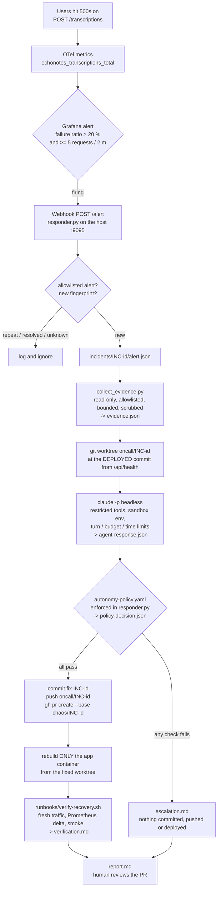

# On-call responder

> Story [US-21](product-spec.md#us-21), issue [#32](https://github.com/mrfmanuel/EchoNotes/issues/32).
> Code: [`incident-response/`](../incident-response/). Signals and the alert: [observability.md](observability.md).
> Principle (module 4): *the model may reason; the system must observe, authorize, verify and remember.*

When the user-impact alert **"EchoNotes transcription failure ratio high"** fires, Grafana calls a
small responder on the host. The responder collects evidence and runs Claude Code headless in an
isolated git worktree. The model proposes a fix. The responder's **code** decides whether that fix
is allowed. It then opens a PR, redeploys the local app and verifies recovery, or it escalates to a
human. Every step is written to an incident folder.

## The loop



## Run it

```bash
make test-responder            # unit tests of the responder logic (stub agent, ~30 s, no Docker)
make incident                  # = incident-response/test-incident.sh, the whole live demo
make incident-cleanup          # remove the incident stack, worktrees, local branches, images
uv run incident-response/responder.py                       # just the responder on 127.0.0.1:9095
uv run incident-response/responder.py --replay incident-response/incidents/INC-x/alert.json
```

`test-incident.sh` does the following, in one command:

1. Creates a worktree on a new branch `chaos/INC-<id>` from `origin/main` and commits
   [`chaos/realtime-factor-zero-division.patch`](../incident-response/chaos/README.md) there.
2. Pushes `chaos/INC-<id>`, the base branch of the responder's PR, so the PR diff is only the fix.
3. Starts app + Postgres + `grafana/otel-lgtm` from that worktree with `docker-compose.yml`
   `--profile observability`, as compose project `echonotes-incident`, with
   `APP_PORT=8001`, `GRAFANA_PORT=3001`, `APP_IMAGE=echonotes-incident:<id>-chaos`,
   `OBS_OTLP_ENDPOINT=http://lgtm:4318` and `ONCALL_WEBHOOK_URL=http://host.docker.internal:9095/alert`.
   The user's `echonotes` stack (`:8000`, image `echonotes:local`) is never touched. The
   responder later rebuilds only `app`, with the same variables and
   `APP_IMAGE=echonotes-incident:<id>-fix`.
4. Starts the responder for exactly one incident.
5. Sends fake-provider traffic (`traffic.py`, 40 % "accidental tap" clips) until the alert fires.
6. Waits for the responder, then prints the incident folder and the PR URL. The stack keeps running
   for screenshots until `--cleanup`.

Prerequisites: Git Bash (or any POSIX shell), Docker, `uv`, `gh` logged in, `claude` logged in.
Use `INCIDENT_PUSH=0` for a dry run that neither pushes nor opens a PR, and
`ONCALL_AGENT_CMD='["python","<repo>/incident-response/tests/stub_agent.py"]' ONCALL_STUB_SCENARIO=chaos_fix`
to replace the model with a stub that applies the known minimal fix and a reproducing test. That
proves the wiring (alert, evidence, policy, rebuild, verification) without a model call.

## Incident folder (`incident-response/incidents/INC-<UTC yyyymmdd-HHMMSS>/`)

| File | Written by | Content |
|---|---|---|
| `incident.json` | responder | id, dedupe key, status (`investigating`, `escalated`, `fix_committed`, `resolved_verified`, ...), branch, commits, PR URL |
| `alert.json` | responder | the Grafana webhook payload (scrubbed) |
| `evidence.json` | `collect_evidence.py` | health/commit, Prometheus results, up to 50 error log lines, 1-3 traces, recent commits, every source queried with its HTTP status |
| `agent-config.json` | responder | model, exact CLI flags, limits, names (not values) of the env vars passed |
| `agent-response.json` | responder | the agent's JSON answer, schema errors, run metadata (turns, cost, duration) |
| `policy-decision.json` | responder | every policy check with pass/fail and detail, the real diff stats |
| `commands.log` | responder | every command executed, cwd, exit code, duration; output tail of failures |
| `pr-body.md` | responder | the PR description |
| `verification.md` | `verify-recovery.sh` | recovery checks and the smoke test output |
| `escalation.md` | responder | only on escalation: why, and what a human should do |
| `report.md` | responder | the summary: deployed version, user impact, evidence, model, decision, recovery |

Absolute paths are rewritten to `<repo>` / `~`, and secret patterns are redacted, in everything
the responder writes. Agent worktrees, clean verification checkouts and the dedupe state live
**outside the repo tree** in `ONCALL_WORK_DIR` (default `<system temp>/echonotes-oncall`), so
relative paths from the agent's worktree never reach the operator's checkout (its `.env`). The
chaos worktree and the responder log of `test-incident.sh` live in the git-ignored
`incident-response/.work/`.

## Capability table of the responder agent

| | Responder (`responder.py`, deterministic code) | Agent (`claude -p`, the model) |
|---|---|---|
| **Trigger** | Grafana webhook, allowlisted alert names/rule UIDs only (`autonomy-policy.yaml`) | started by the responder, once per incident |
| **Runs where** | the operator's host, `127.0.0.1:9095` (Docker Desktop reaches it through `host.docker.internal`) | inside the worktree `<ONCALL_WORK_DIR>/oncall-INC-<id>` (branch `oncall/INC-<id>`, at the deployed commit), outside the repo tree |
| **Reads** | Grafana datasource proxy (Prometheus, Loki, Tempo) with fixed queries, GET only, 10 s timeout, 2 MB cap; `/api/health`; `docker compose logs app` as a log fallback; `git log` | the evidence packet in its prompt and the files of the worktree (`Read`, `Grep`, `Glob`); `.env*` files are denied |
| **Writes** | the incident folder; the approved commit on `oncall/INC-<id>` and its push; `gh pr create`; rebuild of the `app` container of the incident stack | files in the worktree (`Edit`, `Write`) |
| **Executes** | git (hooks disabled, minimal env), gh, docker compose, `verify-recovery.sh`, and the policy checks (pytest, ruff) in a clean checkout | only `uv run pytest ...` and `uv run ruff ...` (`--allowedTools`) |
| **Explicitly denied** | n/a | `Read/Edit/Write(**/.env*)`, `WebFetch`, `WebSearch`, `Task`, `git push`/`commit`, `gh`, `curl`, `wget`, `docker`, `uv add`/`pip` (`--disallowedTools`); no MCP servers (`--strict-mcp-config`); user settings not loaded (`--setting-sources project`); `--permission-mode dontAsk` denies anything not allowlisted |
| **Credentials** | the operator's git credential helper (push) and `gh` login (PR); Grafana `admin/admin` (local stack only) | only its own model login (Claude Code OAuth, or `ANTHROPIC_API_KEY` if set). No `GROQ_API_KEY`, no GitHub token, no Render deploy hooks, no `DATABASE_URL` |
| **Environment** | git runs with an allowlisted env (no `GROQ_API_KEY`, tokens, deploy hooks) but the operator's git config; tests/lint run with the agent's sandbox env; docker compose gets the incident variables with `GROQ_API_KEY=""` | allowlist (`PATH`, home/temp dirs, locale, uv cache) + `TRANSCRIBER_PROVIDER=fake`, `GIT_CONFIG_NOSYSTEM=1`, empty `GIT_CONFIG_GLOBAL` (no credential helper), empty `GH_CONFIG_DIR` (no gh login), `GIT_TERMINAL_PROMPT=0`, unreachable `DOCKER_HOST` |
| **Limits** | one incident at a time; per-command timeouts | `--max-turns 40`, `--max-budget-usd 3`, wall-clock timeout 20 min (process tree killed), `--no-session-persistence` |
| **Can** | open a PR against the explicit incident base branch (`ONCALL_PR_BASE`, e.g. `chaos/INC-<id>`); redeploy the **local** incident stack | read code, write a failing test, edit `backend/app/**` / `backend/tests/**`, run unit tests and ruff |
| **Cannot** | deploy to Render dev/prod, merge PRs, open a PR against `main` (no base configured means no push and no PR, the incident escalates) | push, deploy, open PRs, use the network tools, read secrets from the env or `.env` files. A diff outside the allowlist, a planted git hook or config change, or a deleted test is rejected **before** anything is pushed |
| **Output** | incident folder, PR, rebuilt container | one JSON object matching [`response.schema.json`](../incident-response/response.schema.json) |

**How the decision binds what is pushed.** Agent-written code also runs outside the agent's own
turn: in its `uv run pytest` calls and in the responder's checks. So the responder does not trust
the worktree after the agent finished:

1. Every responder git command runs with `-c core.hooksPath=<empty dir>` (verified empty before each
   call) and `-c core.fsmonitor=false`. The push also uses `--no-verify`. Hooks planted in the shared
   `.git/hooks` never run.
2. `.git/config`, `.git/hooks/**`, `.git/info/**` and `worktrees/*/config.worktree` are
   snapshotted before the agent runs. They are compared after the agent run and again after the
   checks. Any change is restored and the incident escalates (`git_metadata_unchanged`).
3. The commit that would be pushed is built with plumbing (`git write-tree` + `git commit-tree`,
   which runs no hooks and moves no branch). Its diff against the deployed commit must equal the
   evaluated diff (`commit_matches_evaluated_diff`), and its added lines must contain no secret
   pattern (`no_secrets_in_diff`).
4. Tests and lint run in a **fresh checkout of that commit** (`git worktree add`, own `uv sync`).
   The reproduction uses the test files **from that commit** on a fresh checkout of the deployed
   code. Ignored files the agent left behind (`.venv`, `sitecustomize.py`, `.env`) cannot
   influence the result, and the app is rebuilt from the same clean checkout.
5. Only when every check passed is `oncall/INC-<id>` moved to that commit (`git update-ref`) and
   pushed.

**Residual risks (honest list).** The agent runs on the host without an OS sandbox. Code it writes
runs during `uv run pytest` and could in principle reach the network or read files the operator
can read, for example by absolute path. The env holds no tokens, git/gh/docker are
de-credentialed, the worktree is outside the repo, `.env` reads are denied to the tools, the
added lines are secret-scanned, and a human reviews the PR, which targets a throwaway branch.
Next step: run the agent and its checks in a container without network or credentials.

## Autonomy policy (enforced in code)

[`autonomy-policy.yaml`](../incident-response/autonomy-policy.yaml) is read by `responder.py`.
`evaluate_policy()` computes every check from facts (the real `git diff --raw/--numstat`, exit
codes, the JSON schema), never from the agent's claims. The prompt also states the rules, but
only to keep the model on track. Breaking a rule in the prompt changes nothing, because the code
still applies them. A skipped check counts as not passed.

| Check | Rule |
|---|---|
| `agent_run_completed` | the CLI finished with `subtype=success` (no max-turns, budget or timeout stop) |
| `response_matches_schema` | the answer validates against `response.schema.json` |
| `proposed_action_allowed` | `proposed_action` is in `actions.allowed` (`apply_fix`); `escalate` always escalates |
| `confidence_at_least_minimum` | `confidence >= 0.6` |
| `diff_not_empty` | the worktree has changes |
| `paths_allowed` | every changed path matches `backend/app/**` or `backend/tests/**` and none matches a denied glob (`.github/**`, `Dockerfile`, `docker-compose*.yml`, `incident-response/**`, `observability/**`, `*.env*`, `pyproject.toml`, `uv.lock`, migrations) |
| `only_regular_files` | no symlink (mode 120000), no submodule (160000), no absolute, `..` or backslash path |
| `max_changed_lines` / `max_changed_files` | at most 60 lines (added + deleted) and 5 files |
| `no_tests_removed` | no file under `backend/tests/` deleted, no `def test_*` function removed from a test file |
| `test_added_or_changed` | at least one **added** line in a test file under `backend/tests/` |
| `report_matches_diff` | the agent's `files_changed` equals the real diff |
| `commit_matches_evaluated_diff` | the candidate commit (built without hooks) has exactly the evaluated diff (paths, statuses, modes, line counts) |
| `no_secrets_in_diff` | the added lines contain no secret pattern (API keys, tokens, `key=`/`password=` values, credentials in URLs) |
| `new_test_fails_before_fix` | the changed test files from the candidate commit, on a fresh checkout of the deployed commit, **fail** (pytest exit 1): the bug is reproduced |
| `unit_tests_pass` | `uv run pytest -m "not integration" -q` passes in a fresh checkout of the candidate commit |
| `lint_pass` / `format_pass` | `ruff check` and `ruff format --check` pass there |
| `git_metadata_unchanged` | (pipeline) hooks/config of the shared git dir unchanged after the agent and after the checks |

Steps that run code or build the commit only happen when every earlier check passed, so the
responder never executes code from a proposal that already failed a static check.

## Escalation path

Any failed check, or any failed step, triggers the same handling. Failed steps include evidence
collection, an unknown deployed commit, an agent timeout, tampered git metadata, a missing PR base,
and a push, PR or rebuild failure.

1. The responder writes `escalation.md` (reason, failed checks, the agent's unverified hypothesis,
   next steps) and a `policy-decision.json` that says `escalate`. No branch moves, and nothing
   is pushed or deployed, unless the failure came after the push, which `escalation.md` then says.
   A rejected candidate commit stays unreferenced.
2. The worktree stays in `<ONCALL_WORK_DIR>/oncall-INC-<id>` for inspection.
3. The on-call human follows the alert's runbook (`docs/runbooks/transcription-failures.md`):
   check user impact on the dashboard, read `evidence.json`, and roll back if a recent deploy
   correlates ([release-process.md](release-process.md)). The fix then goes through a normal
   issue + PR with the CI + QA gate.

A fix that passed the policy is still only a **proposal**. The PR targets the explicit incident
base branch (`ONCALL_PR_BASE`; the demo sets `chaos/INC-<id>`). There is **no fallback to
`main`**: without a base, the responder pushes nothing, opens no PR and escalates. The demo PR is
closed without merging. A fix that is a genuine hardening for `main` is re-opened against `main`
by a human, through the normal gate.

## Dedupe

The key is the alert rule UID (Grafana's `alerts[].ruleUID`, else the `__alert_rule_uid__` label
or the `generatorURL`) plus Grafana's alert `fingerprint`. A `firing` notification for a key with
an open incident is ignored: Grafana repeats them every repeat interval. A `resolved` notification
closes the key, is noted in that incident's `commands.log`, and never opens an incident. The state
is kept in `<ONCALL_WORK_DIR>/state.json` across restarts. `test-incident.sh` resets it at the
start of a demo.
