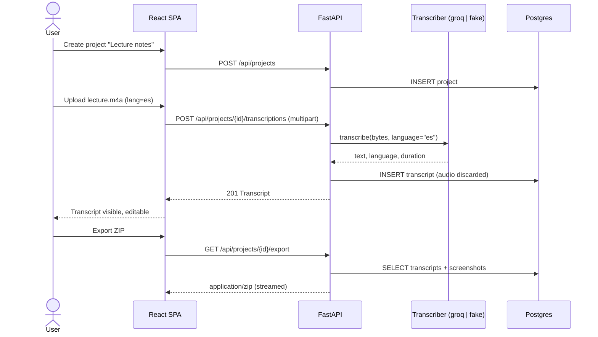

# EchoNotes — Product Specification

| | |
|---|---|
| Status | **Approved for M2 implementation** (v1.0, 2026-11-10) |
| Owner | `product-manager` agent (see [agent-team.md](agent-team.md)) |
| API contract | [`openapi.yaml`](../openapi.yaml) (OpenAPI 3.1) |
| Tracker | [GitHub Issues](https://github.com/mrfmanuel/EchoNotes/issues) · [Milestones](https://github.com/mrfmanuel/EchoNotes/milestones) |

Each user story below has a stable anchor (`#us-01` … `#us-17`, `#nfr-…`). GitHub issues link to these anchors. If a story changes, update this file in the same PR as the issue.

---

## 1. Problem

People who think out loud (students in lectures, developers in meetings, creators drafting ideas) end up with voice memos they never listen to again. The memos are scattered across phone apps, and the screenshots that go with them (a slide, a diagram, an error message) live somewhere else. Turning them into usable text means juggling a recorder, a transcription service, a text editor and a file manager.

**EchoNotes** is a small web app that turns audio into organized text notes. A *project* acts as a folder. Inside it you drop or record audio, get a transcript in seconds, attach the screenshots that belong with it, and export the whole thing as a clean folder of Markdown and images.

## 2. Personas

| Persona | Context | What they need |
|---|---|---|
| **Sofía, the student** | Records 1-hour lectures in Spanish and English and takes screenshots of slides | Transcripts grouped per course, with slide screenshots next to them, exported to her notes app as Markdown |
| **Diego, the developer** | Records short voice memos about bugs and design ideas and pastes error screenshots | Fast record-from-browser, Ctrl+V screenshots, copy the transcript into an issue |
| **Ana, the content creator** | Drafts scripts by talking, in Portuguese and English | Edit the transcript, download `.md`, keep drafts organized per video |

## 3. Scope: user stories and acceptance criteria

Each criterion uses Given/When/Then. "Project page" means the screen of a single project.

### 3.1 Projects

<a id="us-01"></a>
#### US-01 — Create a project
*As a user, I want to create a project with a name so that I can group related notes.*

- **AC1** Given I am on the projects list, when I submit a name of 1–100 characters, then the project appears in the list and I am taken to its page.
- **AC2** Given I submit an empty or whitespace-only name, or a name longer than 100 characters, then I see a validation error and nothing is created (API: `422`).
- **AC3** Given a project is created, then it gets a URL-safe `slug` derived from the name. The slug is unique, and a numeric suffix is added on collision (`notes`, `notes-2`).

<a id="us-02"></a>
#### US-02 — List projects
*As a user, I want to see all my projects so that I can open one.*

- **AC1** Given projects exist, when I open the home page, then I see them sorted by last update (newest first), each with its name, number of transcripts and number of screenshots.
- **AC2** Given no projects exist, then I see an empty state that invites me to create one.

<a id="us-03"></a>
#### US-03 — Rename a project
- **AC1** Given a project, when I rename it to a valid name, then the new name is shown everywhere and `updated_at` changes. The slug stays the same, so export folder names stay stable.
- **AC2** Given an invalid name, then I see the same validation as US-01 AC2.
- **AC3** Given a project ID that does not exist, then the API returns `404`.

<a id="us-04"></a>
#### US-04 — Delete a project
- **AC1** Given a project, when I confirm deletion, then the project and all its transcripts and screenshots are permanently deleted (cascade) and it disappears from the list.
- **AC2** Given I cancel the confirmation dialog, then nothing is deleted.

### 3.2 Audio and transcription

<a id="us-05"></a>
#### US-05 — Upload audio and get a transcript (key journey, step 1)
*As a user, I want to upload an audio file into a project and get its transcript.*

- **AC1** Given a project page, when I choose a file with extension/type `mp3`, `wav`, `m4a`, `ogg` or `webm` of at most 25 MB, then I see a "Transcribing…" state, and when it finishes the new transcript appears in the project's list and opens.
- **AC2** Given a file with another type, then I get a clear error and no transcript is created (API: `415`).
- **AC3** Given a file larger than 25 MB, then I get a clear error before or at upload (API: `413`).
- **AC4** Given the transcription provider fails or times out, then I see an error message with a retry hint, no empty transcript is stored, and the API returns `502` (provider error) or `504` (timeout).
- **AC5** Given a transcript is created, then it stores: title (defaults to the original filename without extension), text, language (detected or hinted), duration in seconds (when the provider returns it), provider name and created time.
- **AC6 (privacy)** Given any upload, then the raw audio bytes are never written to the database or disk beyond the request lifetime (temporary in-memory/temp-file only, deleted in a `finally` block).

<a id="us-06"></a>
#### US-06 — Record audio in the browser
- **AC1** Given a browser that supports `MediaRecorder`, when I click **Record**, grant microphone permission and later click **Stop**, then the recording (webm/ogg) is uploaded and transcribed exactly like US-05.
- **AC2** Given recording is in progress, then I see an elapsed-time indicator and can cancel without uploading.
- **AC3** Given microphone permission is denied or `MediaRecorder` is unsupported, then the Record button shows an explanatory message and file upload still works.

<a id="us-07"></a>
#### US-07 — Language hint
- **AC1** Given the upload/record form, then I can pick a language: **Auto** (default), English (`en`), Spanish (`es`), Portuguese (`pt`).
- **AC2** Given I pick a language other than Auto, then it is sent to the provider as the ISO-639-1 `language` parameter. Given Auto, then no language is sent.
- **AC3** Given an unsupported language value in the API, then the API returns `422`.

<a id="us-08"></a>
#### US-08 — View and edit a transcript
- **AC1** Given a transcript, when I open it, then I see its title, text, language, duration and created date.
- **AC2** When I edit the title (1–200 chars) or the text and save, then the changes persist after reload and `updated_at` changes.
- **AC3** Given unsaved changes, when I navigate away, then I am warned.

<a id="us-09"></a>
#### US-09 — Copy transcript to clipboard
- **AC1** Given a transcript view, when I click **Copy**, then the transcript text is in my clipboard and I see a "Copied" confirmation for about 2 s.

<a id="us-10"></a>
#### US-10 — Download a transcript as `.md` or `.txt`
- **AC1** When I click **Download .md**, then I get `<transcript-slug>.md` containing a `# <title>` heading, a metadata line (date, language, duration), a blank line and the text.
- **AC2** When I click **Download .txt**, then I get `<transcript-slug>.txt` with the plain text only.
- **AC3** Downloads are served by the API with a correct `Content-Type` and `Content-Disposition: attachment`.

<a id="us-11"></a>
#### US-11 — Delete a transcript
- **AC1** Given a transcript, when I confirm deletion, then it is removed. Screenshots linked to it stay in the project, but their link is cleared.

### 3.3 Screenshots

<a id="us-12"></a>
#### US-12 — Attach a screenshot with the file picker
- **AC1** Given a project page, when I pick a `png`, `jpg/jpeg` or `webp` image of at most 5 MB, then it is stored and appears in the gallery.
- **AC2** Given another type or a larger file, then I see an error (API `415` / `413`) and nothing is stored.
- **AC3** The server validates the type by content (magic bytes), not only by extension or the client's MIME type.

<a id="us-13"></a>
#### US-13 — Paste a screenshot from the clipboard (Ctrl+V)
- **AC1** Given the project page is focused, and no text input is focused, when I press Ctrl+V (Cmd+V on macOS) with an image in the clipboard, then it is uploaded like US-12 and appears in the gallery.
- **AC2** Given the clipboard has no image, then nothing happens (no error toast).

<a id="us-14"></a>
#### US-14 — Link a screenshot to a transcript
- **AC1** When uploading or afterwards, I can optionally link a screenshot to one transcript of the same project.
- **AC2** Linking to a transcript of another project returns `422`.
- **AC3** In the transcript view, I see the screenshots linked to it.

<a id="us-15"></a>
#### US-15 — Screenshot gallery and delete
- **AC1** The project page shows a thumbnail grid. Clicking a thumbnail opens the full image.
- **AC2** When I delete a screenshot and confirm, then it disappears from the gallery and the database.

### 3.4 Export

<a id="us-16"></a>
#### US-16 — Export a project as a ZIP (key journey, step 3)
- **AC1** When I click **Export ZIP** on a project, then I download `<project-slug>.zip` with this structure:
  ```
  <project-slug>/
  ├── README.md            # index: project name, export date, table of transcripts and screenshots with relative links
  ├── transcripts/
  │   ├── <transcript-slug>.md
  │   └── <transcript-slug>.txt
  └── screenshots/
      └── <nn>-<original-name-slug>.<ext>
  ```
- **AC2** Transcript files use the same formats as US-10. Duplicate slugs get a numeric suffix.
- **AC3** Given an empty project, then the ZIP still contains `README.md` stating that the project is empty.
- **AC4** The export is built in memory or a temp file and streamed. It is never persisted.

### 3.5 Operations

<a id="us-17"></a>
#### US-17 — Health endpoint
- **AC1** `GET /api/health` returns `200 {"status":"ok","version":"<semver>","database":"ok"}` when the database is reachable.
- **AC2** When the database is unreachable, it returns `503` with `"database":"error"` (planned for M2, when the DB exists; the M1 skeleton returns `"database":"skipped"`).

## 4. Key user journey

> **Upload audio → transcript visible → export**



This journey is the one we instrument and alert on in M4 (see [observability.md](observability.md)).

## 5. Non-functional requirements

<a id="nfr-privacy"></a>
- **NFR-Privacy** Raw audio is not persisted after transcription. Transcript text, titles, image bytes and file contents are **never** written to logs, traces or metrics. Only IDs, sizes, durations, content types, status codes and provider names may be logged.
- <a id="nfr-security"></a>**NFR-Security** Secrets (`GROQ_API_KEY`, `DATABASE_URL`) come only from environment variables and are never committed. Uploads are validated by size and content type.
- <a id="nfr-performance"></a>**NFR-Performance** The API overhead (excluding provider time) is under 500 ms p95 for CRUD endpoints. Transcription of a 5-minute clip on Groq is expected in under 30 s.
- <a id="nfr-portability"></a>**NFR-Portability** The whole system runs locally with one command (`docker compose up --build`) and works without a Groq key (`TRANSCRIBER_PROVIDER=fake`).
- <a id="nfr-testability"></a>**NFR-Testability** All business logic is testable with the `fake` transcriber. CI never calls Groq.

## 6. Constraints and technical decisions

| Decision | Rationale |
|---|---|
| FastAPI + SQLAlchemy 2 + Alembic, Python 3.12, `uv` | Course stack, fast to build, typed |
| Postgres (SQLite only for fast unit tests) | Real persistence and parity with Render |
| **Images stored in the DB (`bytea`)** | Render web services have an ephemeral disk. Images are small (≤ 5 MB) and few per project |
| Audio **not** stored | Privacy and storage cost. The transcript is the artifact |
| `Transcriber` interface with `groq` and `fake` providers | Pluggable, and CI/local work offline and deterministically |
| Groq Whisper, OpenAI-compatible `POST {GROQ_BASE_URL}/audio/transcriptions`, model `whisper-large-v3-turbo` | Verified against [Groq speech-to-text docs](https://console.groq.com/docs/speech-to-text) on 2026-11-10: endpoint `https://api.groq.com/openai/v1/audio/transcriptions`, 25 MB free-tier limit, `language` ISO-639-1, `response_format=verbose_json` returns the duration |
| React + Vite + TypeScript SPA. In production it is served by FastAPI from the same container | One image, one Render service, no CORS in prod |
| Synchronous transcription (request waits) | Simple. Files ≤ 25 MB on Groq finish in seconds. Async jobs are a possible later improvement |

## 7. Non-goals

- User accounts, authentication or authorization (single-user app; deploy URL is treated as personal)
- Multi-tenant sharing or collaboration
- Real-time / streaming transcription
- Speaker diarization, translation, summarization
- Native mobile apps
- Storing or replaying the original audio

## 8. Out-of-scope risks we accept

- No auth means anyone with the URL can see the data. Documented in the README, and the demo uses non-sensitive data.
- Large images in `bytea` make DB backups heavier. This is acceptable at the expected scale.
