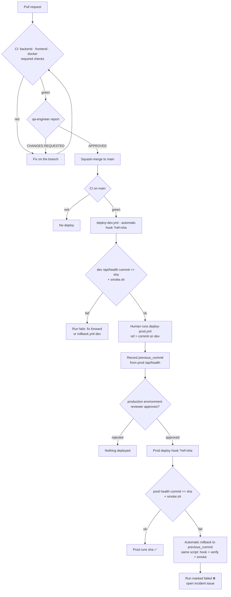

# Release Process

> Status: **live since P3 (M3 Deploy & CI/CD, 2026-11-10).** Environments, secrets and setup: [deployment.md](deployment.md).

## Flow



1. A PR merges to `main` only with the three CI checks green (branch protection) **and** an APPROVED `qa-engineer` report ([process.md](process.md)).
2. CI runs again on `main`. When it succeeds, `deploy-dev.yml` starts automatically (`workflow_run`) and deploys **exactly that commit** to dev. It then waits until `/api/health` reports the commit and runs `scripts/smoke.sh`. Runs created by a failed or cancelled CI skip the deploy job.
3. The human checks dev, then runs `gh workflow run deploy-prod.yml`. With no `ref`, it promotes the commit dev is running now.
4. The run records `previous_commit` (what prod runs now) and then **waits for the `production` reviewer** (`mrfmanuel`). After approval it deploys, verifies the commit, and runs the smoke test. The smoke test creates a `smoke-test-*` project and always deletes it, so prod data stays clean.
5. If any step fails, the run redeploys `previous_commit` with the same script and is still marked failed.

```bash
gh workflow run deploy-dev.yml [-f ref=<sha>]        # manual redeploy of dev (normally automatic)
gh workflow run deploy-prod.yml [-f ref=<sha>]       # promote; empty ref = the commit running on dev
gh workflow run rollback.yml -f environment=dev|prod -f ref=<known-good-sha>
gh run watch                                         # follow it; prod waits for approval
curl -s https://echonotes-prod.onrender.com/api/health   # {"commit": "<sha>", "environment": "prod", ...}
```

All workflows use `scripts/deploy.sh` (see [deployment.md](deployment.md#cd-workflows-and-scriptsdeploysh-25-26-27)). Every run's job summary shows the target SHA, the commit running before, the Render deploy id and the result, so each deploy is traceable to a commit. The deployed commit is also visible at `/api/health` and in the UI footer.

- **Environments:** `production` requires reviewer `mrfmanuel` and is limited to protected branches. `development` is also limited to protected branches, with no reviewer, so only workflow runs on `main` can use the dev deploy hook.
- **Concurrency:**
  - Dev uses the job-level group `deploy-dev`, in `deploy-dev.yml` and in the dev rollback job. A run whose deploy job is skipped (CI failed or was cancelled) never joins the group and never displaces a pending good deploy.
  - Prod uses `deploy-prod`, set at workflow level in `deploy-prod.yml` and at job level in `rollback.yml`.
  - Groups apply across the whole repository, so a deploy and a rollback of the same environment never overlap.
- **Render hook responses:**
  - **200** with a deploy id is confirmed on every live run.
  - **202** ("another deploy in progress") is retried with backoff for up to `DEPLOY_HOOK_WAIT`. It is covered by the mock tests but has not happened live yet.
- **Docs-only pushes to `main`** also run CI and therefore redeploy dev. This is harmless and keeps dev on `main` HEAD.

## Rollback

| Option | When | How |
|---|---|---|
| **Automatic (prod)** | the prod deploy fails at the hook, the commit check or the smoke test | `deploy-prod.yml` redeploys `previous_commit` with `deploy.sh`; the run still fails. Impossible when `previous_commit` is `unknown` (only the very first promotion, from pre-#47 code); the summary then says so |
| **`rollback.yml`** | a bad commit is already running and passed the checks | `gh workflow run rollback.yml -f environment=prod -f ref=<known-good-sha>`. Prod waits for the same approval. Same deploy, verify and smoke steps. `ref` must be on `main` and report `commit` in `/api/health` (any commit from `875b2f8` on) |
| **Render dashboard** | GitHub Actions is unavailable | Service → **Events / Deploys** → pick an earlier successful deploy → **Rollback**. It reuses that deploy's build artifact and is faster, but GitHub has no record of it, so note it in the incident issue, then check `/api/health` and run `scripts/smoke.sh <url>` by hand. Render turns off auto-deploy after a dashboard rollback (ours is already off) |

- Migrations must be backward compatible (expand → migrate → contract), so rolling back the app never requires rolling back the database.
- Log every prod rollback as an incident issue with a timeline.

## Evidence (real runs, 2026-11-10/11)

| What | Run | Result |
|---|---|---|
| CI on `main` for `ebdef98` (merge of PR #49) | [42926527412](https://github.com/mrfmanuel/EchoNotes/actions/runs/42926527412) | ✅ backend, frontend, docker |
| `deploy-dev` from the **cancelled** CI of `875b2f8` | [42926549408](https://github.com/mrfmanuel/EchoNotes/actions/runs/42926549408) | ⏭️ job skipped as designed |
| `deploy-dev`, **automatic** after CI (`workflow_run`) | [42926681099](https://github.com/mrfmanuel/EchoNotes/actions/runs/42926681099) | ✅ hook 200, commit verified after 61 s, smoke passed |
| `deploy-prod`, manual, **waited for approval** by `mrfmanuel` | [42926950100](https://github.com/mrfmanuel/EchoNotes/actions/runs/42926950100) | ✅ `previous_commit=unknown` (first promotion), commit verified after 63 s, smoke passed on prod (project deleted) |
| **Rollback demo:** `rollback.yml` dev → `875b2f8` (previous `main` commit) | [42930045645](https://github.com/mrfmanuel/EchoNotes/actions/runs/42930045645) | ✅ running before `ebdef98`, health showed `875b2f85bb26` after 46 s, smoke passed |
| Redeploy dev to latest `main` (`deploy-dev.yml` dispatch) | [42930329679](https://github.com/mrfmanuel/EchoNotes/actions/runs/42930329679) | ✅ dev back on `ebdef98` |

No hook key appears in any of these logs (`grep -c 'key='` → 0). After the prod deploy, a real Groq transcription of a 9.5 s English clip on prod returned 201 in 1.5 s (provider `groq`). Its test project was deleted afterwards.
